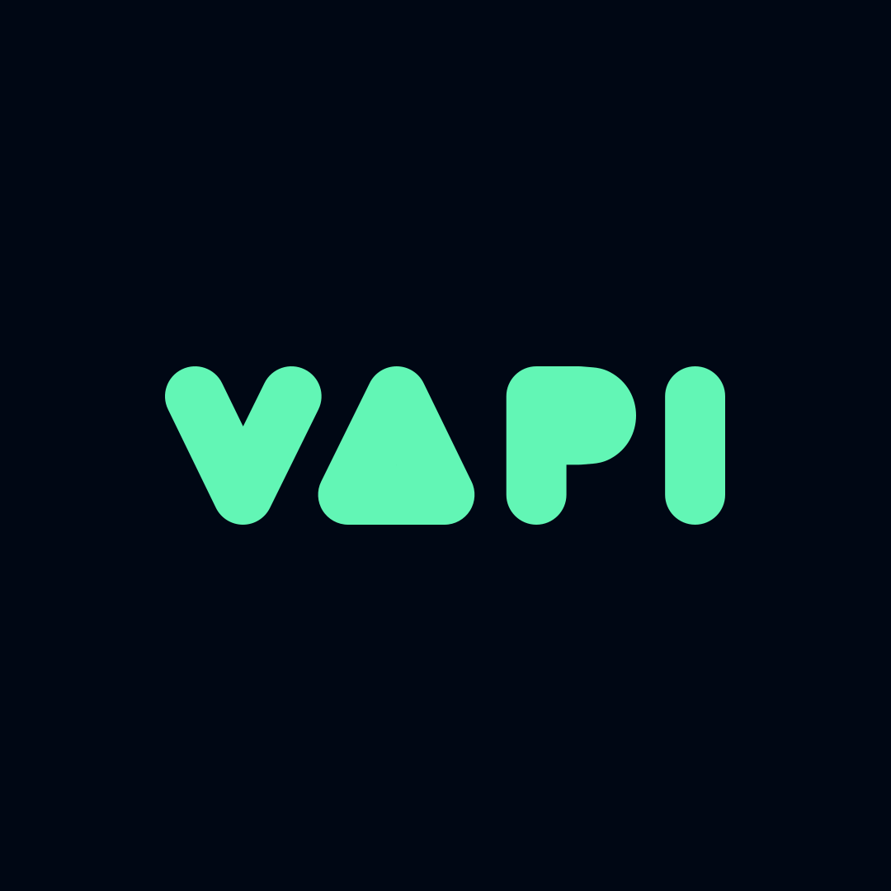

<div align="center">

<picture>
  <source media="(prefers-color-scheme: dark)" srcset="logos/speechmatics-academy-white-2400x600.png">
  <source media="(prefers-color-scheme: light)" srcset="logos/speechmatics-academy-black-2400x600.png">
  
</picture>

<br/>
<br/>

**Code examples, integrations, and templates for Speechmatics APIs and SDKs.**

Explore code examples for transcription, voice-agent applications, and third-party integrations. Each example explains its setup, dependencies, and limitations.


**Examples • Integrations • Use Cases • Developer Guides**

[Browse Examples](#example-categories) • [Quick Start](#quick-start) • [Contributing](#contributing) • [portal](https://portal.speechmatics.com/)  • [Documentation](https://docs.speechmatics.com/) • [Discord Community](https://discord.gg/speechmatics)

</div>

---

## What is Speechmatics?

[Speechmatics](https://www.speechmatics.com/) provides Speech to Text (STT) and Text to Speech (TTS). Use the Batch API for pre-recorded audio, the Realtime API for streaming audio, and agent STT for transcript segments and turn events. Your application or framework combines these with a large language model (LLM), tools, and conversation logic to build a voice agent.

**Flexible Deployment** - SaaS on Cloud and on-prem options. Availability depends on the API and model; check the [deployment documentation](https://docs.speechmatics.com/deployments). Agent STT is available on SaaS on Cloud only.

**Advanced Features** - Model-specific capabilities include a custom dictionary, speaker diarization, speaker identification, smart formatting, and speech intelligence. Check the [model comparison](https://docs.speechmatics.com/speech-to-text/models) before combining features. Speaker focus in an integration may be implemented by the application or framework.

---

## 📋 Table of Contents

- [What is Speechmatics?](#what-is-speechmatics)
- [Quick Start](#quick-start)
- [Example Categories](#example-categories)
- [Community Projects](#community-projects)
- [Migration Guides](#migration-guides)
- [Finding Examples](#finding-examples)
- [Example Structure](#example-structure)
- [Contributing](#contributing)
- [Support & Resources](#support--resources)


---

<h2 id="quick-start">⚡ Quick Start</h2>

### Prerequisites

**1. Get your API key** from the [portal](https://portal.speechmatics.com/). Use Python 3.12 to match the repository's Python CI environment, and check the selected example for additional requirements.


**2. Install the SDK** for your use case in a virtual environment. When running an Academy example, install its supplied requirements as shown below:

```bash
# Choose the package for your use case:

# Batch transcription
pip install speechmatics-batch

# Realtime streaming
pip install speechmatics-rt

# Agent STT: transcript segments plus speech and turn events
pip install speechmatics-agent-stt

# Text to Speech
pip install speechmatics-tts

# Deprecated Voice SDK: maintain existing client-side segmentation integrations
pip install speechmatics-voice
```
<details>

<summary><strong>📦 Package Details</strong> • Click to see what's included in each package</summary>

<br/>

**speechmatics-batch** - Asynchronous transcription with the Batch API
- Upload audio files for processing
- Retrieve transcripts with word timings and supported speaker and entity metadata
- Request speech intelligence features supported by the selected model

**speechmatics-rt** - WebSocket streaming with the Realtime API
- Stream audio for live transcription
- Configure latency for models that support latency controls
- Partial and final transcripts

**speechmatics-agent-stt** - Agent STT with Linden 1, built on `speechmatics-rt` and using the `/v2/agent` endpoint
- Segment-level transcripts instead of word groups, plus speech and turn events
- Use the service's voice activity detection (VAD) to close turns by default
- Or set `TurnDetectionMode.EXTERNAL` to close each turn yourself, when Pipecat, LiveKit or your own VAD already owns that decision
- Pick this for the transcription layer alone, with your own code driving the conversation

**speechmatics-tts** - Text to Speech
- Convert text to natural-sounding speech
- Multiple voices
- Read generated audio incrementally or save the complete response

**speechmatics-voice** - The [deprecated Voice SDK](https://docs.speechmatics.com/integrations-and-sdks/voice-sdk), retained for existing applications
- Client-side turn detection selected through presets
- Speaker diarization and client-side segmentation
- Optional machine-learning turn detection: `pip install "speechmatics-voice[smart]"`
- Start new voice-agent transcription integrations with [agent STT](basics/13-agent-stt/); your application supplies the LLM, TTS, tools, and conversation logic

</details>

<br/>

[SDK Documentation](https://github.com/speechmatics/speechmatics-python-sdk) | [API Reference](https://docs.speechmatics.com/api-ref)

### Option 1: Clone and Run

The commands below use PowerShell. macOS/Linux alternatives are shown in comments.

```powershell
# Clone the repository
git clone https://github.com/speechmatics/speechmatics-academy.git
cd speechmatics-academy

# Navigate to an example
cd basics/01-hello-world/python

# Create a virtual environment (macOS/Linux: python3 -m venv .venv)
python -m venv .venv

# Activate the virtual environment (PowerShell)
.\.venv\Scripts\Activate.ps1
# macOS/Linux: source .venv/bin/activate

# Install dependencies
python -m pip install -r requirements.txt

# Copy the environment template (PowerShell)
Copy-Item ..\.env.example .env
# macOS/Linux: cp ../.env.example .env
# Edit .env and add your SPEECHMATICS_API_KEY

# Run the example
python main.py
```

> [!CAUTION]
> Never hardcode API keys in your source code. Always use environment variables (`.env` files) or secure secret management systems. Never commit `.env` to version control - only `.env.example` with placeholder values.


### Option 2: Direct Copy

Use [degit](https://github.com/Rich-Harris/degit) to copy individual examples:

```bash
# Install degit
npm install -g degit

# Copy an example
degit speechmatics/speechmatics-academy/basics/01-hello-world my-project
cd my-project
```
---

<h2 id="example-categories">📚 Example Categories</h2>

### Fundamentals

Fundamental examples for getting started with the Speechmatics SDK.

| Example | Description | Packages | Difficulty |
|---------|-------------|----------|------------|
| [Hello World](basics/01-hello-world/) | Submit an audio file to the Batch API | `Batch` |  Beginner |
| [Batch vs Realtime](basics/02-batch-vs-realtime/) | Learn the difference between API modes | `Batch` `RT` |  Beginner |
| [Configuration Guide](basics/03-configuration-guide/) | Common configuration options | `Batch` |  Beginner |
| [Text to Speech](basics/06-text-to-speech/) | Convert text to natural-sounding speech | `TTS` |  Beginner |
| [Channel Diarization](basics/10-channel-diarization/) | Multi-channel transcription with speaker attribution | `Voice` `RT` |  Beginner |
| [Melia 1 Multilingual](basics/12-melia-multilingual/) | Transcribe multilingual, code-switching audio with Melia 1 using the Batch API | `Batch` |  Beginner |
| [Audio Intelligence](basics/04-audio-intelligence/) | Extract insights with sentiment, topics, and summaries | `Batch` |  Intermediate |
| [Multilingual & Translation](basics/05-multilingual-translation/) | Select a transcription language and translate streaming output | `RT` |  Intermediate |
| [Basic Turn Detection](basics/07-turn-detection/) | Silence-based turn detection with Realtime SDK | `RT` |  Intermediate |
| [Intelligent Turn Detection](basics/08-voice-agent-turn-detection/) | Turn detection presets in the deprecated Voice SDK | `Voice` |  Intermediate |
| [Speaker ID & Speaker Focus](basics/09-voice-agent-speaker-id/) | Reuse speaker identifiers and apply speaker focus with the deprecated Voice SDK | `Voice` |  Intermediate |
| [Voice API Explorer](basics/11-voice-api-explorer/) | Explore the older preview WebSocket protocol in Python and JavaScript; see the compatibility notes | `WebSocket` |  Intermediate |
| [Agent STT](basics/13-agent-stt/) | Linden 1 transcript segments, speech and turn events, speaker identifiers, and service or external turn detection | `Agent STT` |  Intermediate |

[Browse all basics examples](basics/)

---

### Integrations

Third-party framework and service integrations.

| Integration | Example | Features | Languages |
|-------------|---------|----------|-----------|
| <picture><source media="(prefers-color-scheme: dark)" srcset="integrations/agora/logo/agora-logo-rgb-blue.svg"><source media="(prefers-color-scheme: light)" srcset="integrations/agora/logo/agora-logo-rgb-blue.svg"></picture> | [Conversational AI Voice Agent](integrations/agora/01-conversational-ai-agent/) | Agora RTC audio, RTM transcripts, and a managed pipeline combining Speechmatics STT, an LLM, and TTS | Python, TypeScript |
| <picture><source media="(prefers-color-scheme: dark)" srcset="integrations/livekit/logo/LK_wordmark_darkbg.png"><source media="(prefers-color-scheme: light)" srcset="integrations/livekit/logo/LK_wordmark_lightbg.png"></picture> | [Simple Voice Assistant](integrations/livekit/01-simple-voice-assistant/) | WebRTC, VAD, diarization, focus speakers, passive filtering, speaker identification, LLM, TTS | Python |
| <picture><source media="(prefers-color-scheme: dark)" srcset="integrations/livekit/logo/LK_wordmark_darkbg.png"><source media="(prefers-color-scheme: light)" srcset="integrations/livekit/logo/LK_wordmark_lightbg.png"></picture> | [Telephony with Twilio](integrations/livekit/02-telephony-twilio/) | Phone calls via SIP, LiveKit Agents, Krisp noise cancellation, LLM, TTS | Python |
| <picture><source media="(prefers-color-scheme: dark)" srcset="integrations/livekit/logo/LK_wordmark_darkbg.png"><source media="(prefers-color-scheme: light)" srcset="integrations/livekit/logo/LK_wordmark_lightbg.png"></picture> | [Speaker Focus Voice Agent](integrations/livekit/03-speaker-focus-voice-agent/) | Live diarization, speaker focus (RETAIN/IGNORE), reusable speaker identifiers, application-side focus tools, browser visualizer | Python, JavaScript |
|  | [Simple Voice Bot](integrations/pipecat/01-simple-voice-bot/) | Local audio, VAD, diarization, focus speakers, passive filtering, LLM, TTS, interruptions | Python |
|  | [Simple Voice Bot (Web)](integrations/pipecat/02-simple-voice-bot-web/) | Browser-based WebRTC, VAD, diarization, focus speakers, passive filtering, LLM, TTS | Python |
|  | [Outbound Dialer](integrations/twilio/01-outbound-dialer/) | REST API, outbound calls, Media Streams, deprecated Voice SDK, and ElevenLabs TTS | Python |
| <div align="center"><picture><source media="(prefers-color-scheme: dark)" srcset="integrations/vapi/logo/vapi-light.png"><source media="(prefers-color-scheme: light)" srcset="integrations/vapi/logo/vapi-dark.png"></picture></div> | [Voice Assistant](integrations/vapi/01-voice-assistant/) | Voice AI platform, Speechmatics STT, diarization, custom dictionary, LLM, TTS | Python |
| <div align="center"></div> | [Healthcare Dictation](integrations/tambourine/01-healthcare-dictation/) | Desktop dictation, medical terminology, LLM formatting, clinical documentation | Config |

[Browse all integrations](integrations/)

---

### Use Cases

Example applications for specific industries.

| Industry | Example | Features |
|----------|---------|----------|
| **Healthcare** | [Medical Transcription](use-cases/01-medical-transcription-realtime/) | Realtime API, Enhanced Medical, and a custom dictionary for medical terms |
| **Media** | [Video Captioning](use-cases/02-video-captioning/) | SRT generation, timestamp sync, batch processing |
| **Contact Center** | [Call Analytics](use-cases/03-call-center-analytics/) | Channel diarization, sentiment analysis, topic detection, summarization |
| **Business** | [AI Receptionist](use-cases/04-voice-agent-calendar/) | LiveKit voice agent, Twilio SIP, Google Calendar booking, function calling |
| **Entertainment** | [Santa Voice Agent](use-cases/05-santa-voice-agent/) | LiveKit, ElevenLabs TTS, custom dictionary, Twilio SIP telephony |
| **Healthcare** | [Medical Assistant](use-cases/06-medical-assistant/) | Bilingual Arabic and English transcription, speaker diarization, LLM extraction, and draft clinical notes |
| **Healthcare** | [Medical Microbatching](use-cases/07-medical-microbatching/) | Microphone chunking with Silero VAD, concurrent Batch jobs, and optional speaker identification |
| **Business** | [Alphanumerics Form Filler](use-cases/08-alphanumerics-form-filler/) | LiveKit voice agent, agent STT with framework turn detection, browser RPC form filling, digit-by-digit confirmation |
| **Mobile** | [Mobile Transcription App](use-cases/09-flutter-mobile-transcription/) | Flutter (Android & iOS), Batch API, Melia 1 multilingual transcription, plus model-dependent diarization, speaker identification, translation, and speech intelligence |
| **Events** | [Wall of Voices](use-cases/10-wall-of-voices/) | Realtime Melia 1 multilingual transcription, per-word language tags, browser WebSocket audio, right-to-left rendering, short-lived token endpoint |
| **Healthcare** | [Oak Consultation Studio](use-cases/11-oak-consultation-studio/) · [Live demo](https://oak-consultation-studio.vercel.app/) | Oak 1 multilingual healthcare transcription with the Batch API, synchronized playback, speaker/channel exploration, and a Python token broker; Oak 1 is distinct from Enhanced Medical |

[Browse all use cases](use-cases/)

---

<h2 id="community-projects">🌍 Community Projects</h2>

Projects built by the Speechmatics community. Community projects can use **any language** and follow the [community submission requirements](community/README.md), including the repository's current CI checks.

> [!NOTE]
> No community projects yet - yours could be the first! See [How to Submit](community/README.md#how-to-submit).

<!-- As community projects are added, list them here:
| Project | Category | Description | Language | Author | Status |
|---------|----------|-------------|----------|--------|--------|
| [Example Project](community/use-cases/example/) | Use Case | Example description | Python | [@user](https://github.com/user) |  |
| [Example Tool](community/tools/example/) | Tool | Example description | TypeScript | [@user](https://github.com/user) |  |
-->

Community projects have two quality tiers:

 Maintainer-audited, fully template-compliant, tested end-to-end

 Basic structure, working code, light review

[Browse all community projects](community/) | [Submit a project](community/README.md#how-to-submit) | [Community Template](community/COMMUNITY_TEMPLATE.md)

---

<h2 id="migration-guides">🔄 Migration Guides</h2>

Switching from another Speech to Text provider? Use the migration guides to compare concepts, configuration, and code patterns. Check current SDK versions before adapting snippets.

| From | Guide | Features Covered | Status |
|------|-------|------------------|--------|
| **Deepgram** | [Migration Guide](guides/migration-guides/deepgram/) | Batch, Streaming, Diarization, custom dictionary | **Available** |
| **AssemblyAI** | Migration Guide | Transcription, Audio Intelligence, Real-time | Not yet included |
| **Google Cloud Speech** | Migration Guide  | Batch, Streaming, Multi-language | Not yet included |
| **AWS Transcribe** | Migration Guide | Batch Jobs, Streaming, custom dictionary | Not yet included |
| **Azure Speech** | Migration Guide | REST API, WebSocket, Pronunciation | Not yet included |

> [!NOTE]
> The migration guide provides:
> - **Feature Mapping** - Compare related features and their differences
> - **Code Comparison** - Side-by-side before/after examples
> - **Migration Checklist** - Step-by-step migration process
> - **Evaluation** - Compare services on representative audio and current capabilities
> - **Code Examples** - Supporting scripts with the setup and compatibility notes in the guide

[Browse all migration guides](guides/migration-guides/)

---

<h2 id="finding-examples">🔍 Finding Examples</h2>
Find examples by package, feature, integration, programming language, or difficulty. Follow each example's README for its actual dependencies and setup.

### By Package


| Package | Description | Examples |
|---------|-------------|----------|
| **`speechmatics-batch`** | Asynchronous file transcription with the Batch API | [Hello World](basics/01-hello-world/), [Batch vs Realtime](basics/02-batch-vs-realtime/), [Configuration Guide](basics/03-configuration-guide/), [Audio Intelligence](basics/04-audio-intelligence/), [Multilingual & Translation](basics/05-multilingual-translation/), [Video Captioning](use-cases/02-video-captioning/), [Call Analytics](use-cases/03-call-center-analytics/), [Medical Microbatching](use-cases/07-medical-microbatching/) |
| **`speechmatics-rt`** | Streaming transcription with the Realtime API | [Batch vs Realtime](basics/02-batch-vs-realtime/), [Configuration Guide](basics/03-configuration-guide/), [Multilingual & Translation](basics/05-multilingual-translation/), [Basic Turn Detection](basics/07-turn-detection/), [Channel Diarization](basics/10-channel-diarization/), [Medical Transcription](use-cases/01-medical-transcription-realtime/), [Medical Assistant](use-cases/06-medical-assistant/), [Medical Microbatching](use-cases/07-medical-microbatching/), [Alphanumerics Form Filler](use-cases/08-alphanumerics-form-filler/), [Wall of Voices](use-cases/10-wall-of-voices/) |
| **`speechmatics-voice`** | Deprecated client-side segmentation and turn presets for existing applications | [Intelligent Turn Detection](basics/08-voice-agent-turn-detection/), [Speaker ID & Speaker Focus](basics/09-voice-agent-speaker-id/), [Twilio Outbound Dialer](integrations/twilio/01-outbound-dialer/) |
| **`speechmatics-agent-stt`** | Segment-level STT for voice agents | [Agent STT](basics/13-agent-stt/) |
| **`speechmatics-tts`** | Text to Speech synthesis | [Text to Speech](basics/06-text-to-speech/) |

### By Feature

| Feature | Examples |
|---------|----------|
| **Batch Transcription** | [Hello World](basics/01-hello-world/), [Batch vs Realtime](basics/02-batch-vs-realtime/), [Configuration Guide](basics/03-configuration-guide/), [Audio Intelligence](basics/04-audio-intelligence/), [Video Captioning](use-cases/02-video-captioning/), [Call Analytics](use-cases/03-call-center-analytics/), [Medical Microbatching](use-cases/07-medical-microbatching/), [Mobile Transcription App](use-cases/09-flutter-mobile-transcription/), [Melia 1 Multilingual](basics/12-melia-multilingual/), [Oak Consultation Studio](use-cases/11-oak-consultation-studio/) |
| **Realtime** | [Batch vs Realtime](basics/02-batch-vs-realtime/), [Configuration Guide](basics/03-configuration-guide/), [Basic Turn Detection](basics/07-turn-detection/), [Voice API Explorer](basics/11-voice-api-explorer/), [Agent STT](basics/13-agent-stt/), [Agora Conversational AI Agent](integrations/agora/01-conversational-ai-agent/), [LiveKit Voice Assistant](integrations/livekit/01-simple-voice-assistant/), [Medical Transcription](use-cases/01-medical-transcription-realtime/), [Medical Assistant](use-cases/06-medical-assistant/), [Alphanumerics Form Filler](use-cases/08-alphanumerics-form-filler/), [Wall of Voices](use-cases/10-wall-of-voices/) |
| **Turn Detection** | [Basic Turn Detection](basics/07-turn-detection/), [Intelligent Turn Detection](basics/08-voice-agent-turn-detection/), [Voice API Explorer](basics/11-voice-api-explorer/), [Agent STT](basics/13-agent-stt/) |
| **Voice Agents** | [Intelligent Turn Detection](basics/08-voice-agent-turn-detection/), [Speaker ID & Speaker Focus](basics/09-voice-agent-speaker-id/), [Voice API Explorer](basics/11-voice-api-explorer/), [Agent STT](basics/13-agent-stt/), [Agora Conversational AI Agent](integrations/agora/01-conversational-ai-agent/), [LiveKit Voice Assistant](integrations/livekit/01-simple-voice-assistant/), [Pipecat Voice Bot](integrations/pipecat/01-simple-voice-bot/), [Pipecat Voice Bot (Web)](integrations/pipecat/02-simple-voice-bot-web/), [Twilio Outbound Dialer](integrations/twilio/01-outbound-dialer/), [Vapi Voice Assistant](integrations/vapi/01-voice-assistant/), [AI Receptionist](use-cases/04-voice-agent-calendar/), [Santa Voice Agent](use-cases/05-santa-voice-agent/), [Alphanumerics Form Filler](use-cases/08-alphanumerics-form-filler/), [Speaker Focus Voice Agent](integrations/livekit/03-speaker-focus-voice-agent/) |
| **Speaker Diarization** | [Configuration Guide](basics/03-configuration-guide/), [Speaker ID & Speaker Focus](basics/09-voice-agent-speaker-id/), [Channel Diarization](basics/10-channel-diarization/), [Voice API Explorer](basics/11-voice-api-explorer/), [Agent STT](basics/13-agent-stt/), [LiveKit Voice Assistant](integrations/livekit/01-simple-voice-assistant/), [Call Analytics](use-cases/03-call-center-analytics/), [Medical Assistant](use-cases/06-medical-assistant/), [Mobile Transcription App](use-cases/09-flutter-mobile-transcription/), [Speaker Focus Voice Agent](integrations/livekit/03-speaker-focus-voice-agent/), [Oak Consultation Studio](use-cases/11-oak-consultation-studio/) |
| **Speaker Identification** | [Speaker ID & Speaker Focus](basics/09-voice-agent-speaker-id/), [Agent STT](basics/13-agent-stt/), [Voice API Explorer](basics/11-voice-api-explorer/), [LiveKit Voice Assistant](integrations/livekit/01-simple-voice-assistant/), [Mobile Transcription App](use-cases/09-flutter-mobile-transcription/), [Speaker Focus Voice Agent](integrations/livekit/03-speaker-focus-voice-agent/) |
| **Sentiment Analysis** | [Audio Intelligence](basics/04-audio-intelligence/), [Call Analytics](use-cases/03-call-center-analytics/) |
| **Topic Detection** | [Audio Intelligence](basics/04-audio-intelligence/), [Call Analytics](use-cases/03-call-center-analytics/), [Mobile Transcription App](use-cases/09-flutter-mobile-transcription/) |
| **Summarization** | [Audio Intelligence](basics/04-audio-intelligence/), [Call Analytics](use-cases/03-call-center-analytics/), [Mobile Transcription App](use-cases/09-flutter-mobile-transcription/) |
| **Translation** | [Multilingual & Translation](basics/05-multilingual-translation/), [Mobile Transcription App](use-cases/09-flutter-mobile-transcription/) |
| **Text to Speech** | [Text to Speech](basics/06-text-to-speech/) |

### By Integration

| Integration | Examples | Documentation | Status |
|-------------|----------|---------------|--------|
| **Agora** | [Conversational AI Voice Agent](integrations/agora/01-conversational-ai-agent/) | [Agora Conversational AI Docs](https://docs.agora.io/en/conversational-ai/overview/product-overview) | **Available** |
| **LiveKit** | [Simple Voice Assistant](integrations/livekit/01-simple-voice-assistant/), [Telephony with Twilio](integrations/livekit/02-telephony-twilio/), [AI Receptionist](use-cases/04-voice-agent-calendar/), [Santa Voice Agent](use-cases/05-santa-voice-agent/), [Alphanumerics Form Filler](use-cases/08-alphanumerics-form-filler/), [Speaker Focus Voice Agent](integrations/livekit/03-speaker-focus-voice-agent/) | [LiveKit Docs](https://docs.livekit.io/agents/models/stt/plugins/speechmatics/) | **Available** |
| **Pipecat AI** | [Simple Voice Bot](integrations/pipecat/01-simple-voice-bot/), [Simple Voice Bot (Web)](integrations/pipecat/02-simple-voice-bot-web/) | [Pipecat Docs](https://docs.pipecat.ai/server/services/stt/speechmatics#speechmatics) | **Available** |
| **Twilio** | [Outbound Dialer](integrations/twilio/01-outbound-dialer/), [Telephony with Twilio](integrations/livekit/02-telephony-twilio/), [AI Receptionist](use-cases/04-voice-agent-calendar/), [Santa Voice Agent](use-cases/05-santa-voice-agent/) | [Twilio Media Streams](https://www.twilio.com/docs/voice/media-streams) | **Available** |
| **Vapi** | [Voice Assistant](integrations/vapi/01-voice-assistant/) | [docs.vapi.ai](https://docs.vapi.ai/) | **Available** |
| **Tambourine** | [Healthcare Dictation](integrations/tambourine/01-healthcare-dictation/) | [GitHub](https://github.com/nicobailey/tambourine-voice) | **Available** |

### By Language

| Language | Examples | Status |
|----------|----------|--------|
| **Python** | [Hello World](basics/01-hello-world/), [Batch vs Realtime](basics/02-batch-vs-realtime/), [Configuration Guide](basics/03-configuration-guide/), [Audio Intelligence](basics/04-audio-intelligence/), [Multilingual & Translation](basics/05-multilingual-translation/), [Text to Speech](basics/06-text-to-speech/), [Basic Turn Detection](basics/07-turn-detection/), [Intelligent Turn Detection](basics/08-voice-agent-turn-detection/), [Speaker ID & Speaker Focus](basics/09-voice-agent-speaker-id/), [Channel Diarization](basics/10-channel-diarization/), [Voice API Explorer](basics/11-voice-api-explorer/), [Agora Conversational AI Agent](integrations/agora/01-conversational-ai-agent/), [LiveKit Voice Assistant](integrations/livekit/01-simple-voice-assistant/), [LiveKit Telephony](integrations/livekit/02-telephony-twilio/), [Pipecat Voice Bot](integrations/pipecat/01-simple-voice-bot/), [Pipecat Voice Bot (Web)](integrations/pipecat/02-simple-voice-bot-web/), [Twilio Outbound Dialer](integrations/twilio/01-outbound-dialer/), [Vapi Voice Assistant](integrations/vapi/01-voice-assistant/), [Medical Transcription](use-cases/01-medical-transcription-realtime/), [Video Captioning](use-cases/02-video-captioning/), [Call Analytics](use-cases/03-call-center-analytics/), [AI Receptionist](use-cases/04-voice-agent-calendar/), [Santa Voice Agent](use-cases/05-santa-voice-agent/), [Medical Assistant](use-cases/06-medical-assistant/), [Medical Microbatching](use-cases/07-medical-microbatching/), [Alphanumerics Form Filler](use-cases/08-alphanumerics-form-filler/), [Melia 1 Multilingual](basics/12-melia-multilingual/), [Speaker Focus Voice Agent](integrations/livekit/03-speaker-focus-voice-agent/), [Wall of Voices](use-cases/10-wall-of-voices/), [Agent STT](basics/13-agent-stt/), [Oak Consultation Studio](use-cases/11-oak-consultation-studio/) | **Available** |
| **Dart / Flutter** | [Mobile Transcription App](use-cases/09-flutter-mobile-transcription/) | **Available** |
| **JavaScript** | [Voice API Explorer](basics/11-voice-api-explorer/), [Speaker Focus Voice Agent](integrations/livekit/03-speaker-focus-voice-agent/), [Wall of Voices](use-cases/10-wall-of-voices/), [Oak Consultation Studio](use-cases/11-oak-consultation-studio/) | **Available** |
| **TypeScript** | [Agora Conversational AI Agent](integrations/agora/01-conversational-ai-agent/) | **Available** |
| **C#** | - | Not yet included |


### By Difficulty

| Difficulty | Examples |
|------------|----------|
| **Beginner** | [Hello World](basics/01-hello-world/), [Batch vs Realtime](basics/02-batch-vs-realtime/), [Configuration Guide](basics/03-configuration-guide/), [Text to Speech](basics/06-text-to-speech/), [Channel Diarization](basics/10-channel-diarization/), [Vapi Voice Assistant](integrations/vapi/01-voice-assistant/), [Tambourine Healthcare Dictation](integrations/tambourine/01-healthcare-dictation/), [Video Captioning](use-cases/02-video-captioning/), [Call Analytics](use-cases/03-call-center-analytics/), [Melia 1 Multilingual](basics/12-melia-multilingual/) |
| **Intermediate** | [Audio Intelligence](basics/04-audio-intelligence/), [Multilingual & Translation](basics/05-multilingual-translation/), [Basic Turn Detection](basics/07-turn-detection/), [Intelligent Turn Detection](basics/08-voice-agent-turn-detection/), [Speaker ID & Speaker Focus](basics/09-voice-agent-speaker-id/), [Voice API Explorer](basics/11-voice-api-explorer/), [Agora Conversational AI Agent](integrations/agora/01-conversational-ai-agent/), [LiveKit Voice Assistant](integrations/livekit/01-simple-voice-assistant/), [Pipecat Voice Bot](integrations/pipecat/01-simple-voice-bot/), [Pipecat Voice Bot (Web)](integrations/pipecat/02-simple-voice-bot-web/), [Medical Transcription](use-cases/01-medical-transcription-realtime/), [Medical Microbatching](use-cases/07-medical-microbatching/), [Alphanumerics Form Filler](use-cases/08-alphanumerics-form-filler/), [Mobile Transcription App](use-cases/09-flutter-mobile-transcription/), [Speaker Focus Voice Agent](integrations/livekit/03-speaker-focus-voice-agent/), [Wall of Voices](use-cases/10-wall-of-voices/), [Agent STT](basics/13-agent-stt/), [Oak Consultation Studio](use-cases/11-oak-consultation-studio/) |
| **Advanced** | [LiveKit Telephony](integrations/livekit/02-telephony-twilio/), [Twilio Outbound Dialer](integrations/twilio/01-outbound-dialer/), [AI Receptionist](use-cases/04-voice-agent-calendar/), [Santa Voice Agent](use-cases/05-santa-voice-agent/), [Medical Assistant](use-cases/06-medical-assistant/) |


---


<h2 id="example-structure">📁 Example Structure</h2>

Small Python examples generally follow this structure. Web and mobile applications use framework-specific layouts described in their READMEs:

```
example-name/
├── python/
│   ├── main.py             # Primary Python implementation
│   ├── requirements.txt    # Python dependencies
│   └── .gitignore          # Ignore venv/, __pycache__/, .env
├── assets/                 # Sample files, images, etc.
│   ├── sample.wav          # Sample audio (if needed)
│   └── agent.md            # Agent prompt (for voice agents)
├── .env.example            # Environment variables template
└── README.md               # Main documentation (REQUIRED)
```

> [!NOTE]
> The example template calls for:
>
> 1. **What You'll Learn** - Key concepts covered
> 2. **Prerequisites** - Required setup
> 3. **Quick Start** - Step-by-step instructions
> 4. **How It Works** - Step-by-step explanation
> 5. **Key Features** - Demonstrated capabilities
> 6. **Expected Output** - Sample results
> 7. **Next Steps** - Related examples
> 8. **Troubleshooting** - Common issues
> 9. **Resources** - Relevant documentation

---

<h2 id="contributing">🤝 Contributing</h2>

We welcome contributions! There are many ways to help:

### Ways to Contribute

1. **Add New Examples** - Share your implementations
2. **Submit Community Projects** - Share your own projects in any language ([learn more](community/README.md))
3. **Improve Existing Examples** - Fix bugs, add features
4. **Add Language Support** - Port examples to other languages
5. **Fix Documentation** - Improve README files
6. **Report Issues** - Help us improve quality

### Adding a New Example

1. **Choose category** (basics/integrations/use-cases)
2. **Follow structure** (see [EXAMPLE_TEMPLATE.md](docs/EXAMPLE_TEMPLATE.md))
3. **Add metadata** to [docs/index.yaml](docs/index.yaml)
4. **Write README** using the template
5. **Test thoroughly**
6. **Submit PR** with clear description

See [CONTRIBUTING.md](docs/CONTRIBUTING.md) for detailed guidelines.

### Quality Standards

> [!NOTE]
> All examples must meet these standards:
>
> - Clean, readable code following the conventions of its implementation language
> - Follows SDK best practices
> - Includes error handling and resource cleanup
> - No hardcoded secrets
> - Complete documentation
> - Tested with the documented runtime; validation and untested live steps are stated
> - Metadata in index.yaml

---

<h2 id="support--resources"> 🆘 Support & Resources</h2>

### Getting Help


- **GitHub Issues**: [Report bugs or request examples](https://github.com/speechmatics/speechmatics-academy/issues)
- **GitHub Community Discussions**: [Ask questions, share projects](https://github.com/speechmatics/community/discussions/categories/academy)
- **Discord Community**: [Join our Discord](https://discord.gg/speechmatics)
- **Email Support**: devrel@speechmatics.com

### Resources

- **SDK Repository**: [speechmatics-python-sdk](https://github.com/speechmatics/speechmatics-python-sdk)
- **API Documentation**: [docs.speechmatics.com](https://docs.speechmatics.com) · [Release notes](https://speechmatics.featurebase.app/en/changelog)
- **Developer portal**: [portal.speechmatics.com](https://portal.speechmatics.com)
- **Blog**: [speechmatics.com/blog](https://www.speechmatics.com/blog)

### Documentation

- **[Example Template](docs/EXAMPLE_TEMPLATE.md)** - Template for new examples
- **[Contributing Guide](docs/CONTRIBUTING.md)** - How to contribute

---

## 📄 License

This project is licensed under the MIT License - see the [LICENSE](LICENSE) file for details.

---

## 🔗 Links

- **SDK**: [github.com/speechmatics/speechmatics-python-sdk](https://github.com/speechmatics/speechmatics-python-sdk)
- **Docs**: [docs.speechmatics.com](https://docs.speechmatics.com)
- **portal**: [portal.speechmatics.com](https://portal.speechmatics.com)

---

<div align="center">

**Built with ❤️ by the Speechmatics Community**

[Twitter](https://twitter.com/speechmatics) • [LinkedIn](https://linkedin.com/company/speechmatics) • [YouTube](https://youtube.com/@speechmatics)

</div>
