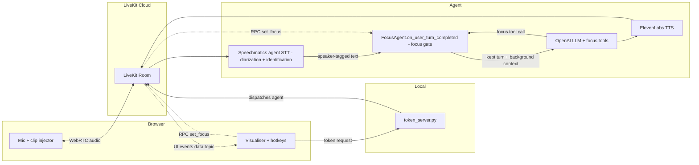

<div align="center">

<picture>
  <source media="(prefers-color-scheme: dark)" srcset="../logo/LK_wordmark_darkbg.png">
  <source media="(prefers-color-scheme: light)" srcset="../logo/LK_wordmark_lightbg.png">
  
</picture>

# Speaker Focus - Filter Voice Agent Responses by Speaker

**Use speaker diarization and speaker identification to decide which completed turns reach a LiveKit voice agent, with controls for focusing on or ignoring speakers.**

</div>

This example combines Speechmatics Speech to Text (STT), an OpenAI large language model (LLM), and ElevenLabs Text to Speech (TTS) in a LiveKit application. The STT plugin uses **agent STT**, powered by **Linden 1**, on the Realtime API.

Speechmatics labels speakers and can match saved speaker identifiers. The application's `FocusAgent.on_user_turn_completed` callback then filters completed turns before the LLM responds. A browser visualizer shows transcripts and focus events. This application-side filtering is a conversation control, not speaker authentication.

## What You'll Learn

- **Diarization** - labelling every voice live (`S1`, `S2`, ...) with `enable_diarization` and a custom `speaker_format`
- **Speaker focus** - `RETAIN` keeps a turn as background context and suppresses an immediate reply; `IGNORE` excludes it from the LLM context. The application implements both in `FocusAgent.on_user_turn_completed`, with changes through `set_focus` RPC or LLM tools
- **The ignore list** - excluding one specific speaker's completed turns from the LLM context
- **Speaker identification** - saving speaker identifiers with `get_speaker_ids()` and recognizing enrolled speakers via `known_speakers`
- **Voice-driven control** - LLM function tools that change the focus ("ignore everyone else")
- **Turn detection** - service-side voice activity detection (VAD) with `TurnDetectionMode.VAD` and `turn_handling=TurnHandlingOptions(turn_detection="stt")`; a separate Silero VAD supports interruptions
- **Custom dictionary** - `additional_vocab` so the STT spells "Otto" and "Speechmatics" correctly

## Prerequisites

- **Speechmatics API key**: Create one in the [Speechmatics portal](https://portal.speechmatics.com/)
- **LiveKit Cloud Account**: Sign up at [cloud.livekit.io](https://cloud.livekit.io/) (URL, API key, API secret)
- **OpenAI API key**: for the LLM
- **ElevenLabs API key**: for TTS
- **Python 3.10+** (Python 3.12 recommended)
- **A microphone** and a Chromium browser (Chrome/Edge) - mic capture happens in the browser, no PyAudio needed

## Project Structure

```
03-speaker-focus-voice-agent/
├── python/
│   ├── main.py           # the voice agent (diarization + focus + memory + tools)
│   ├── token_server.py   # room tokens + agent dispatch (port 8790)
│   ├── requirements.txt
│   └── .gitignore        # keeps .env and speakers.json out of git
├── frontend/             # no-build browser visualiser (static files)
├── assets/
│   └── agent.md          # the agent's system prompt (Otto, a pizzeria agent)
├── .env.example
└── README.md
```

## Quick Start

You'll run **three processes** in three terminals: the agent, the token server, and the frontend.

**Step 1: Create and activate a virtual environment**

On Windows (PowerShell):
```powershell
cd python
python -m venv .venv
.venv\Scripts\Activate.ps1
```

On Windows (cmd):
```bat
cd python
python -m venv .venv
.venv\Scripts\activate.bat
```

On Mac/Linux:
```bash
cd python
python3 -m venv .venv
source .venv/bin/activate
```

**Step 2: Install dependencies**

```bash
pip install -r requirements.txt
```

**Step 3: Configure environment**

```bash
cp ../.env.example .env      # cmd.exe: copy ..\.env.example .env
# Edit .env and fill in all six values
```

`.env` can live next to the code in `python/` or at the example root — the
scripts check both.

**Step 4: Start the three processes**

All three run at the same time, one terminal each. The agent itself is
headless - the browser UI in Step 5 only appears once all three are up.

Terminal 1 - the agent worker, from `python/` (wait for `registered worker`;
it stays running in this console):
```bash
python main.py dev
```

Terminal 2 - the token + dispatch server, from `python/`:
```bash
python token_server.py
```

Terminal 3 - the frontend static server (plain global Python is fine here -
no packages needed). Step into the `frontend/` folder and serve it:
```bash
cd frontend        # from the example root (from python/ use: cd ../frontend)
python -m http.server 8748
```

**Step 5: Open the app**

1. Go to **http://localhost:8748** in Chrome.
2. Allow the microphone.
3. Click once anywhere on the page (browser autoplay policy - this unlocks the agent's voice).

Within a couple of seconds the status flips to **agent joined - listening** and the agent (Otto) greets you.

## Architecture



The one loop that makes this example special: the LLM's focus tools and the hotkey RPC both update the same in-memory lock (`LockState`); `FocusAgent.on_user_turn_completed` reads that lock on every turn to decide whether a speaker's words reach the LLM at all, become silent background context, or are dropped outright.

## How It Works

Your mic is published into a **LiveKit room**; the agent joins that room and runs the audio through the **Speechmatics STT plugin**, which diarizes it and tags every finalized segment with a speaker label (`[S1]: ...`) via a custom `speaker_format`. The STT never decides who gets a reply - that decision is made entirely by the agent, in `FocusAgent.on_user_turn_completed`, which runs after a turn is finalized and before the LLM ever sees it. An LLM function tool or a hotkey just changes which speakers are focused or ignored; the gate reads that state on every turn.

The focus state itself is a plain in-memory lock (`LockState`), flipped by three small functions, live mid-session, no restart:

```python
# RETAIN: prioritise S1, everyone else stays as tagged background
apply_focus(["S1"], FocusMode.RETAIN)

# IGNORE: drop everyone but S1 before their turns ever reach the LLM
apply_focus(["S1"], FocusMode.IGNORE)

# reset: hear and answer everyone equally again
apply_clear()
```

`on_user_turn_completed` then classifies every speaker segment in the finalized turn against that lock and rewrites the message before it reaches the chat context:

```python
keep, background = [], []
for who, said in lines:
    state = self._lock.spk_state(who)
    if state == "ignored":
        continue
    if state == "passive":
        background.append(BACKGROUND_FMT.format(speaker_id=who, text=said))
    else:
        keep.append(SPEAKER_FMT.format(speaker_id=who, text=said))
```

**RETAIN vs IGNORE.** Both modes send the incoming audio to STT; filtering happens after transcription. With `RETAIN` (the default), a non-focused turn is tagged `(background)` and added to the LLM's chat context through `update_chat_ctx`. `StopResponse()` suppresses an immediate reply, while the text remains available for later context. With `IGNORE`, the gate skips that turn and raises `StopResponse()` without adding it to the LLM context.

**Two more levers.** The **ignore list** (`LockState.ignore`) silences specific speakers independently of the focus mode - useful for muting one heckler while everyone else stays active; `spk_state` checks it first, so an ignored speaker is dropped regardless of focus. And the `dominant()`/`other()` heuristics used to resolve "me" and "the other speaker" for the hotkeys skip any label prefixed with `__` (reserved for the agent's own participant), so those labels are excluded from hotkey target selection.

**Turn detection precedes filtering.** The STT uses `turn_detection_mode=TurnDetectionMode.VAD`, and the session uses `turn_handling=TurnHandlingOptions(turn_detection="stt")` to consume its turn events. The session's separate Silero VAD supports barge-in. Any audible speech can interrupt playback, including a background speaker; the focus gate decides afterward whether the completed turn should produce a reply.

**Background context is still LLM input.** The prompt in `assets/agent.md` asks the model to treat `(background)` lines as context rather than instructions and to resolve “me” from the speaker tag. The application suppresses immediate replies to background-only turns, but retained text can influence a later reply. Use `IGNORE` when those turns should be excluded from the LLM context.

**Speaker identification.** During a session, Speechmatics builds speaker identifiers. Press `E` to retrieve them with `stt.get_speaker_ids()` and save them to `python/speakers.json`. Rename a label (for example, `Speaker_1` to `Edgar`) and restart to supply that profile through `known_speakers`. When the service matches the voice, its transcript uses the saved label, which the application can then use as a focus target:

```python
stt = speechmatics.STT(
    enable_diarization=True,
    known_speakers=[
        SpeakerIdentifier(label="Edgar", speaker_identifiers=["XX...XX"]),
    ],
)
```

A speaker profile can hold several identifiers; collecting them across sessions and devices and merging them into the existing profile (rather than overwriting it) can improve recognition across recording conditions. This example overwrites the file on enrollment; merging profiles would require an application change.

## Using It

Talk to the agent normally, then change who it listens to - by voice or by hotkey.

### By voice (the LLM calls the tools)

| Say | Effect |
|-----|--------|
| "Otto, I want you to focus on my voice" | **RETAIN** - you drive the conversation; others become background |
| "Otto, I want you to ignore everyone else" | **IGNORE** - everyone else is dropped entirely |
| "Otto, ignore her" | adds that speaker to the ignore list |
| "Otto, listen to everyone" | resets - hear everyone equally |

### By hotkey (manual override)

| Key | Action |
|-----|--------|
| `F` | Focus you (RETAIN) |
| `O` | Only you (IGNORE - drop everyone else) |
| `I` | Ignore the latest other speaker |
| `C` | Clear the focus |
| `E` | Enroll voiceprints to `speakers.json` |
| `P` | Pause - stop sending your mic to the agent |
| `V` | Vertical 9:16 layout |
| `S` | Toggle the on-screen buttons |
| `H` | Toggle the hotkey/clip help overlay |
| `1`-`9` / `Space` | Play / stop loaded audio clips (multi-speaker testing without extra people) |

## Key Features

- **One focus gate** - `FocusAgent.on_user_turn_completed` is the single place a turn gets kept, backgrounded, or dropped; focus, ignore and clear just flip the lock state it reads
- **Live mid-session switching** - no restart, no reconnect
- **Voice-driven** - four `@function_tool`s let the model change the focus; it resolves "me" from the speaker tag on the request
- **Deliberate persistence** - speaker identifiers are written to disk only when you press `E`; diarization operates throughout the session
- **Clip injection** - load audio clips and fire them into the published mic track with keys `1`-`9` to simulate a crowd single-handedly

## Expected Output

With no focus set, all speakers' turns can trigger a response. After “I want you to ignore everyone else”, the events panel shows a focus change and the gate drops other speakers' completed turns before they reach the LLM. Their transcripts still appear in the browser with an `IGNORED` tag. In `RETAIN` mode, other speakers' lines appear with a `PASSIVE` tag and enter the LLM context without triggering an immediate response.

After enrollment, renaming, and restart, matched transcript segments use the saved name. The browser's `DROPPED` counter is currently a microphone-level heuristic, not a measured count of turns rejected by the focus gate; use the gate's event messages to inspect actual decisions.

## Local demo and speaker identifiers

The token server is intended for local development. It has no application authentication and accepts arbitrary room names. Before exposing it, add caller authentication, room authorization, request limits, and a restricted browser origin. The browser also renders incoming transcript/event values as HTML; escape those values before sharing a hosted version.

Speaker identifiers are derived from people's voices. Obtain consent before saving them, protect `python/speakers.json`, and delete profiles when no longer needed. The file is gitignored in this example. Speaker identification and focus controls do not establish a user's identity or permissions.

## Troubleshooting

**"waiting for agent" / no reply** - Make sure Terminal 1 (the agent) is running, then reload the browser tab. Each page load creates a fresh room with its own dispatch, so a reload recovers a stuck session on its own.

**No agent voice** - Click once anywhere on the page (browser autoplay policy).

**The agent hears or talks over itself** - Echo cancellation is on by default; on open speakers use headphones, or check the OS "listen to this device" setting is off.

**Enrollment says "no voice captured yet"** - Say a few full sentences, then press `E` again. Clear speech and longer samples give the service more evidence to distinguish speakers.

**Authentication errors** - Re-check all six values in your `.env` (no stray spaces).

## Next Steps

- [Agent STT](../../../basics/13-agent-stt/) - use the current Speechmatics SDK directly
- [Speaker identification with the legacy Voice SDK](../../../basics/09-voice-agent-speaker-id/) - compare the earlier SDK approach
- [Simple Voice Assistant](../01-simple-voice-assistant/) - the plain LiveKit + Speechmatics starting point

## Resources

- [Speaker identification](https://docs.speechmatics.com/speech-to-text/realtime/speaker-identification)
- [Diarization](https://docs.speechmatics.com/speech-to-text/features/diarization) - separating a transcript into speakers
- [LiveKit Speechmatics plugin](https://github.com/livekit/agents/tree/main/livekit-plugins/livekit-plugins-speechmatics)
- [LiveKit Agents docs](https://docs.livekit.io/agents/)

---

**Time to Complete**: 20 minutes
**Difficulty**: Intermediate
**API Mode**: Realtime — agent STT
**Stack**: LiveKit Agents + Speechmatics STT plugin - Python + browser

[Back to LiveKit Integrations](../) | [Back to Academy](../../../README.md)
