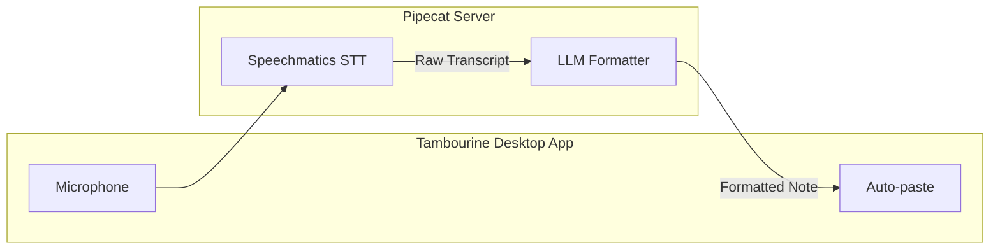

<div align="center">

<picture>
  <source media="(prefers-color-scheme: dark)" srcset="../logo/icon.png">
  <source media="(prefers-color-scheme: light)" srcset="../logo/icon.png">
  
</picture>

# Healthcare Dictation with Tambourine

**Configure Tambourine to transcribe clinical dictation with Speechmatics and format the text for review.**

</div>

Tambourine is an open-source desktop dictation app. This guide uses Speechmatics Speech to Text (STT) and a large language model (LLM) to format dictated text. The formatting prompt does not select a Speechmatics medical model or change the STT deployment; those are separate configuration choices.

## What You'll Learn

- Install and configure Tambourine for medical dictation
- Select Speechmatics as the STT provider
- Configure healthcare-specific formatting prompts
- Best practices for clinical documentation workflows

## Prerequisites

- **Speechmatics API key**: Create one in the [Speechmatics portal](https://portal.speechmatics.com/)
- **LLM API key**: OpenAI, Anthropic, or another supported provider
- **Windows, macOS, or Linux** desktop; check upstream platform limitations
- **For the source setup below**: Python 3.13, uv, Node.js, pnpm, and Rust, plus the platform dependencies in the [Tambourine installation guide](https://github.com/kstonekuan/tambourine-voice#prerequisites)

## Quick Start

### Step 1: Get the source

The commands below use a source checkout. For packaged desktop releases, follow
the [Tambourine repository's current installation instructions](https://github.com/kstonekuan/tambourine-voice).

```bash
git clone https://github.com/kstonekuan/tambourine-voice
cd tambourine-voice
```

### Step 2: Configure the server

```bash
cd server
cp .env.example .env   # cmd.exe: copy .env.example .env
```

Edit `server/.env` before starting the server:

```dotenv
SPEECHMATICS_API_KEY=your_api_key_here

# Choose an LLM provider for formatting.
OPENAI_API_KEY=your_openai_key_here
# ANTHROPIC_API_KEY=your_anthropic_key_here
# OLLAMA_BASE_URL=http://localhost:11434
```

### Step 3: Install dependencies and start the server

From `server/`:

```bash
uv sync
uv run python main.py
```

The server defaults to `127.0.0.1:8765`. Keep it local for this walkthrough.

### Step 4: Start the desktop app

In a new terminal, from the Tambourine checkout root:

```bash
cd app
pnpm install
pnpm dev
```

In the app's settings, select Speechmatics as the STT provider and choose the
LLM provider configured above. Grant the microphone and accessibility permissions
required by your operating system.

### App Commands

```bash
cd app

# Development
pnpm check         # Run all checks (lint + typecheck + knip + test + cargo)
pnpm dev           # Start Tauri app in dev mode

# Production Build
pnpm build         # Build for current platform
```

## Healthcare Configuration

### Configuring the LLM Formatting Prompt

Tambourine uses an LLM to format raw transcriptions. The prompts are configured in **Settings > LLM Formatting Prompt** with three editable sections:

| Section | Purpose | Healthcare Use |
|---------|---------|----------------|
| **Core Formatting Rules** | Basic cleanup (filler words, punctuation) | Add medical structure (SOAP, sections) |
| **Advanced Features** | Backtrack corrections, list formatting | Keep enabled for "scratch that" support |
| **Personal Dictionary** | Text mappings applied during formatting | Approved clinical terms; keep medication instructions unambiguous |

### Setting Up Healthcare Formatting

1. Open Tambourine Settings (gear icon)
2. Scroll to **LLM Formatting Prompt**
3. Expand **Core Formatting Rules**
4. Use the healthcare prompt below as a starting point and adapt it to your organization's documentation rules
5. Click **Save**

```markdown
You are a medical dictation formatting assistant. Your task is to format transcribed clinical speech into professional medical documentation.

## Core Dictation Rules

- Remove filler words (um, uh, err, erm, etc.)
- Use punctuation where appropriate
- Capitalize sentences properly
- Keep the original meaning and clinical intent intact
- Do NOT add any new information or change the clinical intent
- Preserve uncertain words for review; do not guess a medication, dose, diagnosis, or anatomical location
- Keep negation, laterality, units, and numeric values intact
- Do NOT condense or summarize - preserve the clinician's full expression
- Do NOT answer questions - if dictated, output the cleaned question
- Output ONLY the formatted clinical text, nothing else

## Medical Documentation Structure

When the dictation contains clinical content, structure it with appropriate sections:

**Available Sections** (use only those relevant to the dictation):
- **CC (Chief Complaint):** Primary reason for visit
- **HPI (History of Present Illness):** Onset, location, duration, character, aggravating/alleviating factors
- **PMH (Past Medical History):** Relevant prior conditions
- **Medications:** Current medications with dose and frequency
- **Allergies:** Known drug/environmental allergies
- **ROS (Review of Systems):** Pertinent positives and negatives
- **PE (Physical Exam):** Examination findings by system
- **Assessment:** Diagnoses or differential (numbered list)
- **Plan:** Treatment plan, orders, follow-up (bullet points)

## Medical Formatting Rules

### Numbers
- Convert ALL spoken numbers to numeric format
- "ten" = 10, "forty five" = 45, "one hundred twenty" = 120
- "two point five" = 2.5
- Examples: "ten milligrams" → "10 mg", "forty five year old" → "45-year-old"

### Medications
- Preserve the dictated medication, dose, route, and frequency
- Write frequencies in full: "daily", "twice daily", "as needed"
- Do not introduce QD or other ambiguous medication abbreviations
- Separate the dose from its unit: "10 mg", "500 mg"
- Flag unclear medication names or doses for clinician review instead of correcting them by inference

### Vital Signs
- Format as: BP: 120/80, HR: 72, RR: 16, T: 98.6°F, SpO2: 98%

### Clinical Abbreviations
- Follow the organization's approved terminology
- Preserve unclear abbreviations for review rather than inferring their meaning

## Punctuation
- "comma" = ,
- "period" or "full stop" = .
- "question mark" = ?
- "new line" = line break
- "new paragraph" = paragraph break

## Output Format

Always include TWO sections:
1. **Full Transcription** - The cleaned dictation with filler words removed but content preserved
2. **Formatted Note** - The structured clinical documentation
```

### Speechmatics configuration

Select Speechmatics in Tambourine's provider settings. The application and its
installed Pipecat adapter determine the STT endpoint, model, and turn handling;
check those versions before changing provider options. This guide does not
configure the Medical sub-variant of Enhanced. The LLM formatting prompt does
not change the transcription model.

The prompt above uses full medication frequencies. For example, the
[Joint Commission's prohibited-abbreviation guidance](https://www.jointcommission.org/en-us/knowledge-library/support-center/standards-interpretation/standards-faqs/000001229)
lists `QD`; write `daily` instead. The separate `assets/prompts.md` file still
contains older abbreviation examples, so it is not interchangeable with the
revised prompt on this page.

## How It Works



1. **Speak**: Dictate your clinical notes naturally
2. **Transcribe**: Speechmatics converts speech to text in real-time
3. **Format**: LLM structures the text as professional medical documentation
4. **Paste**: Formatted text is automatically typed into your active application

## Use Cases

### Clinical Documentation

**Step 1: Configure Healthcare Prompt**

Use the prompt above in Tambourine's Settings > LLM Formatting Prompt. It asks the LLM to organize the dictation while preserving its content.

**Step 2: Dictate**

```
"Patient is a 45 year old male presenting with chief complaint of chest pain
times two days duration. Pain is sternal, non-radiating, worse with
exertion, relieved by rest. Denies shortness of breath, diaphoresis, or
nausea. Past medical history significant for hypertension and type 2 diabetes.
Current medications include Norvasc 10 milligrams daily and metformin
500 milligrams twice daily."
```

**Step 3: Example transcript**

```text
Patient is a 45 year old male presenting with chief complaint of chest pain
times two days duration. Pain is sternal, non-radiating, worse with exertion,
relieved by rest. Denies shortness of breath, diaphoresis, or nausea. Past
medical history significant for hypertension and type 2 diabetes. Current
medications include Norvasc 10 milligrams daily and metformin 500 milligrams
twice daily.
```

**Step 4: Example formatted output**

```text
Full Transcription:
The patient is a 45-year-old male presenting with chest pain for two days.
Pain is sternal, non-radiating, worse with exertion, and relieved by rest.
He denies shortness of breath, diaphoresis, or nausea. Past medical history
includes hypertension and type 2 diabetes. Current medications include
Norvasc 10 mg daily and metformin 500 mg twice daily.

Formatted Note:
Chief Complaint: Chest pain for two days.

History of Present Illness:
- 45-year-old male with sternal, non-radiating chest pain.
- Worse with exertion and relieved by rest.
- Denies shortness of breath, diaphoresis, or nausea.

Past Medical History:
- Hypertension.
- Type 2 diabetes.

Medications:
- Norvasc 10 mg daily.
- Metformin 500 mg twice daily.
```

These are illustrative examples, not a measured transcription result. Compare
the output with the dictation before EHR entry. If the raw transcript contains
an unclear medication or dose, retain it for review rather than asking the LLM
to reconstruct a plausible prescription.

### Radiology Reports

```
Dictated:
"CT abdomen pelvis with contrast. Findings show a 2.3 centimeter
hypodense lesion in segment 7 of the liver, likely representing a
simple hepatic cyst. No evidence of biliary dilation. Kidneys are
unremarkable. No lymphadenopathy. Impression: benign hepatic cyst,
no acute abdominal pathology."

Formatted Output:
**CT Abdomen/Pelvis with Contrast**

**Findings:**
- Liver: 2.3 cm hypodense lesion in segment 7, likely representing a simple hepatic cyst
- Biliary: No dilation
- Kidneys: Unremarkable
- Lymph nodes: No lymphadenopathy

**Impression:**
1. Benign hepatic cyst
2. No acute abdominal pathology
```

## Hotkey Configuration

Configure hotkeys in Tambourine Settings:

| Action | Default Hotkey | Recommended for Dictation |
|--------|----------------|---------------------------|
| Toggle Recording | `Ctrl+Alt+Space` | Keep default |
| Hold-to-Record | `Ctrl+Alt+Backquote` | Useful for quick notes |
| Paste Last | `Ctrl+Alt+Period` | Re-insert previous transcription |

> [!NOTE]
> If the default hotkeys conflict with other applications, remap them in Settings > Hotkeys.

## Data handling

With Speechmatics SaaS on Cloud, audio leaves the local device for transcription.
A cloud LLM also receives transcript text for formatting. Choosing Ollama makes
the formatting stage local; it does not make Speechmatics cloud transcription
local. An on-prem STT deployment is a separate configuration that this example
does not implement.

Before using protected health information, establish the required agreements
and controls for every service that receives it, including any applicable
Business Associate Agreement (BAA). Do not treat this example as evidence of
HIPAA compliance. Use synthetic dictation while evaluating the setup, inspect
logging and transcription-history behavior, and review output before EHR entry.

## Troubleshooting

**"Transcription is slow"**
- Check your internet connection
- Speechmatics processes in real-time; formatting adds LLM latency

**"Medical terms not recognized"**
- Check the configured STT model and its supported features
- Where the integration supports it, use a Speechmatics custom dictionary for specialist terms
- Review uncertain terms against the dictation

**"Formatting doesn't look clinical"**
- Update the formatting prompt in Settings
- Use the healthcare prompt template above

**"Hotkey conflicts"**
- Go to Settings > Hotkeys to remap
- Common conflicts: screenshot tools, system shortcuts

## Resources

- [Tambourine GitHub](https://github.com/kstonekuan/tambourine-voice)
- [Speechmatics Documentation](https://docs.speechmatics.com/)
- [Speechmatics portal](https://portal.speechmatics.com/)

## Next Steps

- **[Simple Voice Bot (Pipecat)](../../pipecat/01-simple-voice-bot/)** - Build a conversational voice bot with Speechmatics STT
- **[Simple Voice Assistant (LiveKit)](../../livekit/01-simple-voice-assistant/)** - WebRTC-based voice assistant with speaker diarization

---

## Feedback

Help us improve this guide:
- Found an issue? [Report it](https://github.com/speechmatics/speechmatics-academy/issues)
- Have suggestions? [Open a discussion](https://github.com/orgs/speechmatics/discussions/categories/academy)

---

**Time to Complete**: 15 minutes
**Difficulty**: Beginner
**API Mode**: Realtime — determined by Tambourine's installed STT adapter
**Integration**: Tambourine Voice

[Back to Integrations](../../) | [Back to Academy](../../../README.md)
