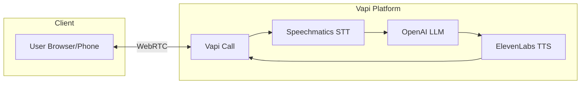

<div align="center">

<picture>
  <source media="(prefers-color-scheme: dark)" srcset="../logo/vapi-light.png">
  <source media="(prefers-color-scheme: light)" srcset="../logo/vapi-dark.png">
  
</picture>

# Vapi Voice Assistant with Speechmatics

**Build a Vapi assistant with Speechmatics Speech to Text (STT) as its transcription provider.**

Vapi coordinates the STT, OpenAI large language model (LLM), and ElevenLabs Text to Speech (TTS) stages. This example selects the Speechmatics Enhanced model through Vapi's streaming transcription integration; it does not configure agent STT or Linden 1.

</div>

## What You'll Learn

- Creating Vapi assistants with Speechmatics transcriber
- Configuring transcription settings (language, operating point, diarization)
- Managing assistants via the Vapi Server SDK

## Prerequisites

- **Vapi Account**: Sign up at [vapi.ai](https://vapi.ai/)
- **Vapi Private Key**: Get from [dashboard.vapi.ai](https://dashboard.vapi.ai/)
- **Speechmatics API key**: Add to Vapi Dashboard under **Provider Keys**
- **Docker** or **Python 3.10+** (Python 3.12 recommended)

## Quick Start

### Step 1: Configure API key

```bash
cp .env.example .env
# Edit .env and add your VAPI_API_KEY (private key)
```

### Step 2: Build and Run

**Using Docker (recommended):**

```bash
docker compose build --no-cache
docker compose run --rm vapi python main.py
```

**Using Python directly:**

On Windows (PowerShell):
```powershell
cd python
python -m venv .venv
.venv\Scripts\Activate.ps1
pip install -r requirements.txt
python main.py
```

On Mac/Linux:
```bash
cd python
python3 -m venv .venv
source .venv/bin/activate
pip install -r requirements.txt
python main.py
```

The script loads the example-root `.env` created in Step 1.

### Step 3: Test Your Assistant

After creating an assistant, test it in the [Vapi Dashboard](https://dashboard.vapi.ai/):

1. Go to **Assistants**
2. Select your assistant
3. Click **Test** to start a voice call

## Usage

```bash
# Create a new assistant with Speechmatics STT
docker compose run --rm vapi python main.py

# List all assistants
docker compose run --rm vapi python main.py list

# Get assistant details
docker compose run --rm vapi python main.py get <assistant-id>

# Delete an assistant
docker compose run --rm vapi python main.py delete <assistant-id>
```

## Architecture



### Pipeline Flow

1. **User** speaks into browser or phone via Vapi Dashboard
2. **Vapi Call** handles WebRTC connection and audio streaming
3. **Speechmatics STT** transcribes speech to text with diarization
4. **OpenAI LLM** generates intelligent responses
5. **ElevenLabs TTS** converts text to natural speech
6. **Audio** streams back to user in real-time

## How It Works

### Configure Speechmatics Transcriber

```python
from vapi import Vapi
from vapi.types import SpeechmaticsTranscriber, OpenAiModel, ElevenLabsVoice

client = Vapi(token=vapi_token)

assistant = client.assistants.create(
    name="Speechmatics Assistant",
    transcriber=SpeechmaticsTranscriber(
        provider="speechmatics",
        model="default",
        language="en",
        operating_point="enhanced",
        region="us",
        max_delay=3000,
        enable_diarization=True,
        remove_disfluencies=True,
        numeral_style="written",
        end_of_turn_sensitivity=0.5,
        minimum_speech_duration=0.2,
        custom_vocabulary=[
            {"content": "Speechmatics", "sounds_like": ["speech matics", "speech mattics"]},
            {"content": "Vapi", "sounds_like": ["vappy", "vahpee", "vaypee", "v a p i", "vap ee"]},
        ],
    ),
    model=OpenAiModel(
        provider="openai",
        model="gpt-4o-mini",
        messages=[{"role": "system", "content": "You are a helpful voice assistant. Keep responses brief and conversational."}],
    ),
    voice=ElevenLabsVoice(provider="11labs", voice_id="21m00Tcm4TlvDq8ikWAM"),
    first_message="Hello! How can I help you today?",
    end_call_message="Goodbye!",
)
```

## Speechmatics Transcriber Options

### Core Settings

| Parameter | Type | Description |
|-----------|------|-------------|
| `provider` | string | Must be `"speechmatics"` |
| `model` | string | `"default"` |
| `language` | string | A language code supported by Vapi's Speechmatics transcriber, such as `"en"` |
| `operating_point` | string | `"standard"` selects Standard; `"enhanced"` selects Enhanced |
| `region` | string | `"eu"` or `"us"` (choose closest to users) |

### Speaker diarization

| Parameter | Type | Description |
|-----------|------|-------------|
| `enable_diarization` | boolean | Separate the transcript into distinct speakers |

### Transcription Behavior

| Parameter | Type | Description |
|-----------|------|-------------|
| `max_delay` | number | Max delay in ms (lower = faster, less accurate) |
| `remove_disfluencies` | boolean | Remove "um", "uh", etc. |
| `numeral_style` | string | `"written"` or `"spoken"` |

### Turn Detection

| Parameter | Type | Description |
|-----------|------|-------------|
| `end_of_turn_sensitivity` | number | Sensitivity for detecting end of speech (0.0-1.0) |
| `minimum_speech_duration` | number | Minimum speech-segment duration in seconds |

### Custom dictionary

| Parameter | Type | Description |
|-----------|------|-------------|
| `custom_vocabulary` | array | Vapi's field for custom dictionary entries, with optional `sounds_like` |

### Fallback Plan (advanced)

| Parameter | Type | Description |
|-----------|------|-------------|
| `fallback_plan` | object | Configures backup transcriber providers if Speechmatics is unavailable. See [Vapi fallback docs](https://docs.vapi.ai/api-reference/types/server/fallback-transcriber-plan). Omitted from this example for brevity. |

### Full Example

```python
from vapi.types import SpeechmaticsTranscriber

transcriber = SpeechmaticsTranscriber(
    provider="speechmatics",
    model="default",
    language="en",
    operating_point="enhanced",
    region="us",
    max_delay=3000,
    enable_diarization=True,
    remove_disfluencies=True,
    numeral_style="written",
    end_of_turn_sensitivity=0.5,
    minimum_speech_duration=0.2,
    custom_vocabulary=[
        {"content": "Speechmatics", "sounds_like": ["speech matics", "speech mattics"]},
        {"content": "Vapi", "sounds_like": ["vappy", "vahpee", "vaypee", "v a p i", "vap ee"]},
    ],
)
```

## Expected Output

After creating an assistant, the script prints its name and identifier:

```text
Created: Speechmatics Assistant (<assistant-id>)
Test at: https://dashboard.vapi.ai/
```

This configuration demonstrates speaker diarization, a custom dictionary, and
smart formatting through Vapi's `numeral_style` field. Consult the
[Vapi Speechmatics provider guide](https://docs.vapi.ai/providers/transcriber/speechmatics)
for the current supported languages and provider options.

## Troubleshooting

**"Invalid API key"**
- Verify `VAPI_API_KEY` in `.env` is your **private** key
- Ensure Speechmatics key is added in Vapi Dashboard under **Provider Keys**

**"Transcription not working"**
- Check Speechmatics key has sufficient credits
- Verify language code is valid


## Resources

- [Vapi Documentation](https://docs.vapi.ai/)
- [Vapi Dashboard](https://dashboard.vapi.ai/)
- [Speechmatics on Vapi](https://docs.vapi.ai/providers/transcriber/speechmatics)
- [Speechmatics Languages](https://docs.speechmatics.com/speech-to-text/languages)

---

## Feedback

Help us improve this guide:
- Found an issue? [Report it](https://github.com/speechmatics/speechmatics-academy/issues)
- Have suggestions? [Open a discussion](https://github.com/orgs/speechmatics/discussions/categories/academy)

---

**Time to Complete**: 15 minutes
**Difficulty**: Beginner
**API Mode**: Realtime — streaming through Vapi
**Languages**: Python

[Back to Integrations](../../) | [Back to Academy](../../../README.md)
