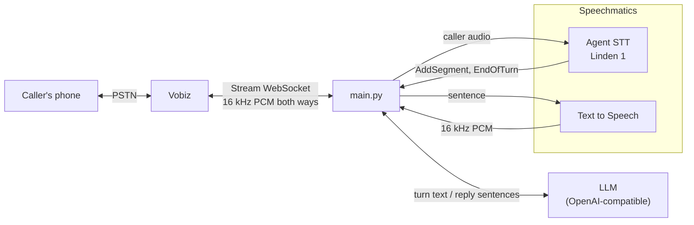

<div align="center">

<picture>
  <source media="(prefers-color-scheme: dark)" srcset="../logo/vobiz-dark.png">
  <source media="(prefers-color-scheme: light)" srcset="../logo/vobiz-light.png">
  
</picture>

# Phone Voice Agent - Vobiz + Speechmatics

**Answer phone calls with a voice agent that listens with Speechmatics agent STT and speaks with Speechmatics Text to Speech.**

</div>

A Vobiz phone number streams the caller's audio to a small Python server over a bidirectional WebSocket. The server sends that audio to Speechmatics [agent STT](https://docs.speechmatics.com/speech-to-text/agent-stt) (Linden 1), the Speech to Text (STT) interface for voice agents, which detects the end of each caller turn. The turn goes to an LLM, and each sentence of the reply is synthesized with [Speechmatics Text to Speech (TTS)](https://docs.speechmatics.com/text-to-speech/quickstart) and played back into the call over the same WebSocket. No voice-agent framework or media server sits in between.

The LLM is any OpenAI-compatible chat completions endpoint. The default is Gemini through its [OpenAI-compatible API](https://ai.google.dev/gemini-api/docs/openai).

## What You'll Learn

- How to connect a Vobiz call to your server with a bidirectional `<Stream>` and play audio back with `playAudio`
- How to use the agent STT WebSocket protocol directly: `StartRecognition`, `AddSegment`, `StartOfTurn` and `EndOfTurn`
- How to stream Speechmatics TTS output as 16 kHz PCM into a phone call, one sentence at a time
- How to handle barge-in with `clearAudio`, and how to hang up after the goodbye has played with `checkpoint` and `stop`

## Prerequisites

- **Speechmatics API key**: Create one in the [Speechmatics portal](https://portal.speechmatics.com/)
- **Gemini API key** (or another OpenAI-compatible LLM): Get one from [Google AI Studio](https://aistudio.google.com/apikey)
- **Vobiz account**: Sign up at [vobiz.ai](https://vobiz.ai/), buy a voice-capable number, and note your Auth ID and Auth Token from the [Vobiz console](https://console.vobiz.ai/)
- **A public HTTPS tunnel** to your machine, such as [ngrok](https://ngrok.com/) or [cloudflared](https://developers.cloudflare.com/cloudflare-one/connections/connect-networks/do-more-with-tunnels/trycloudflare/)
- **Python 3.12**

> [!NOTE]
> Speechmatics TTS supports English voices. Agent STT supports the languages listed in the [agent STT documentation](https://docs.speechmatics.com/speech-to-text/agent-stt); set `SM_LANGUAGE` to change the transcription language.

## Quick Start

> [!IMPORTANT]
> The answer URL, hangup URL, and audio WebSocket share a random path token that changes on every run unless you set `PATH_TOKEN`. The sample does not validate Vobiz callback signatures. Keep the token private, and add signature validation before exposing the server for anything other than a test.

### Python

**Step 1: Create and activate a virtual environment**

**On Windows (PowerShell):**
```powershell
cd python
python -m venv .venv
.\.venv\Scripts\Activate.ps1
```

**On macOS/Linux:**
```bash
cd python
python3 -m venv .venv
source .venv/bin/activate
```

**Step 2: Install dependencies**

```bash
python -m pip install -r requirements.txt
```

**Step 3: Start a tunnel**

In a second terminal, forward a public HTTPS URL to port 8765:

```bash
ngrok http 8765
```

Copy the `https://` forwarding URL.

**Step 4: Configure your keys**

**PowerShell:**

```powershell
Copy-Item ..\.env.example .env
```

**macOS/Linux:**

```bash
cp ../.env.example .env
```

Edit `python/.env` and set `SPEECHMATICS_API_KEY`, `GEMINI_API_KEY`, and `PUBLIC_URL` (the tunnel URL). Set the `VOBIZ_*` values if you want to place outbound calls with `dial.py`.

> [!IMPORTANT]
> **Why `.env`?** Never commit API keys to version control. The `.env` file keeps secrets out of your code.

**Step 5: Start the agent**

```bash
python main.py
```

It prints the answer URL:

```
00:16:56 Answer URL: https://abc123.ngrok-free.app/answer/Xq3...
00:16:56 Hangup URL: https://abc123.ngrok-free.app/hangup/Xq3...
```

**Step 6: Make a call**

**Option A: Call the agent.** In the Vobiz console, create an application with the printed answer URL and hangup URL (method `POST`), attach your Vobiz number to it, then dial the number from any phone.

**Option B: Have the agent call you.** In a third terminal, from the `python` folder with the virtual environment active:

```bash
python dial.py +919876543210 --answer-url https://abc123.ngrok-free.app/answer/Xq3...
```

Your phone rings from `VOBIZ_FROM_NUMBER`. Answer it and start talking. Outbound calls are billed to your Vobiz account.

## Architecture



## How It Works

> [!NOTE]
> 1. **Answer**: Vobiz fetches `/answer/<token>`. The server returns a `<Stream bidirectional="true" keepCallAlive="true" audioTrack="inbound" contentType="audio/x-l16;rate=16000">` element that points at `/ws/<token>`.
> 2. **Listen**: Vobiz sends a `start` event, then 20 ms `media` frames of 16-bit PCM. The server forwards the decoded frames to agent STT as binary messages.
> 3. **Detect the turn**: Agent STT returns finalized `AddSegment` messages and an `EndOfTurn` when the caller has finished. The server joins the turn's segments and sends them to the LLM.
> 4. **Speak**: The LLM reply is streamed and split into sentences. Each sentence is sent to Speechmatics TTS with `output_format=pcm_16000`; the audio is streamed back to Vobiz in 60 ms `playAudio` messages as it arrives.
> 5. **Barge-in**: When agent STT reports `StartOfTurn` or `SpeechStarted` while the agent is talking, the server cancels the reply and sends `clearAudio` so Vobiz drops the queued audio.
> 6. **Hang up**: When the LLM ends its goodbye with `[END_CALL]`, the server sends a `checkpoint`. Vobiz answers with `playedStream` once the goodbye has played, and the server sends `stop` to end the call.

### Code Walkthrough

Start an agent STT session with the same audio format Vobiz sends:

```python
self.stt = await self.http.ws_connect(
    SM_STT_URL, headers={"Authorization": f"Bearer {SM_API_KEY}"}, heartbeat=20
)
await self.stt.send_str(json.dumps({
    "message": "StartRecognition",
    "audio_format": {"type": "raw", "encoding": "pcm_s16le", "sample_rate": 16000},
    "transcription_config": {"language": LANGUAGE, "model": "linden-1", "enable_partials": True},
}))
```

React to turns instead of running your own silence detection:

```python
elif kind == "AddSegment":
    self.turn_text.append(data["segment"]["transcript"].strip())
elif kind == "EndOfTurn":
    text = " ".join(self.turn_text).strip()
    self.reply_task = asyncio.create_task(self.reply(text))
elif kind in ("StartOfTurn", "SpeechStarted"):
    await self.barge_in()
```

Stream TTS audio straight into the call. The PCM format matches what `playAudio` declares, so no resampling is needed:

```python
async with self.http.post(SM_TTS_URL.format(voice=SM_VOICE), json={"text": text},
                          headers={"Authorization": f"Bearer {SM_API_KEY}"}) as r:
    async for chunk in r.content.iter_chunked(CHUNK):
        await self.play_pcm(chunk)  # base64 inside {"event": "playAudio", ...}
```

The full implementation is in [`python/main.py`](python/main.py). The agent's instructions are in [`assets/agent.md`](assets/agent.md).

## Expected Output

```
00:17:01 CALL      started call=4b0c... format={'encoding': 'audio/x-l16', 'sampleRate': 16000}
00:17:02 AGENT     Hi, I'm Vee, the Vobiz voice assistant. ... What would you like to know?
00:17:02 STT       Speechmatics session started 1b4f6675-...
00:17:11 CALLER    Can you tell me in one sentence what Vobiz is?
00:17:13 AGENT     Vobiz is a cloud telephony platform that provides phone numbers, voice calls, and tools for call control.
00:17:13 LATENCY   end of caller turn -> first agent audio: 1584 ms
00:17:40 BARGE-IN  caller spoke over the agent, clearing audio
00:18:05 CALL      goodbye played, ending the call
00:18:05 CALL      ended
```

`LATENCY` measures from agent STT's `EndOfTurn` to the first TTS audio sent to Vobiz. It includes the LLM's time to the first sentence, so it depends on the model you choose.

## Key Features Demonstrated

**Agent STT turn detection:**
- The server never measures silence itself. `EndOfTurn` starts a reply, and `StartOfTurn` interrupts one.

**Streaming Text to Speech:**
- Replies are spoken sentence by sentence, so the caller hears the first sentence while the LLM is still writing the rest.

**Native phone audio:**
- Vobiz sends and accepts 16-bit PCM at 16 kHz, which is what agent STT takes and what TTS returns with `output_format=pcm_16000`. There is no transcoding in either direction.

## Configuration Options

| Variable | Default | Purpose |
|---|---|---|
| `SM_VOICE` | `sarah` | TTS voice: `sarah`, `theo` (UK English), `megan`, `jack` (US English) |
| `SM_LANGUAGE` | `en` | Agent STT language |
| `SM_STT_URL` | `wss://eu2.rt.speechmatics.com/v2/agent` | Agent STT endpoint |
| `LLM_BASE_URL` | Gemini OpenAI-compatible URL | Any OpenAI-compatible base URL |
| `LLM_MODEL` | `gemini-3.1-flash-lite` | Chat model |
| `LLM_REASONING_EFFORT` | `minimal` | Sent as `reasoning_effort`; set it empty for models that reject the field |
| `PORT` | `8765` | Local port |
| `PATH_TOKEN` | random per run | Secret path segment for the answer URL and WebSocket |

Change what the agent knows and how it talks by editing [`assets/agent.md`](assets/agent.md).

## Next Steps

- **[Live Call Transcription](../02-live-call-transcription/)** - transcribe both people on a bridged Vobiz call with channel diarization
- **[Agent STT Linden 1](../../../basics/13-agent-stt/)** - the agent STT message flow in detail
- **[Text to Speech](../../../basics/06-text-to-speech/)** - the TTS SDK and voices

## Troubleshooting

**`Missing required settings in .env: ...`**
- Copy `.env.example` to `python/.env` and fill in the listed values.

**The call connects, then hangs up at once**
- Vobiz could not fetch the answer URL. Check that the tunnel forwards to port 8765 and that the application's answer URL matches the one `main.py` printed, including the token. Restarting `main.py` without `PATH_TOKEN` generates a new token.

**The call is silent and the log shows `STT could not connect` or `TTS error 401`**
- Check `SPEECHMATICS_API_KEY`.

**`LLM error 400` or `LLM error 404`**
- Check `LLM_MODEL` is available to your key. If the error mentions `reasoning_effort`, set `LLM_REASONING_EFFORT=` (empty).

**The agent talks over the caller, or stops too early**
- Barge-in is driven by agent STT. Background noise on the caller's side can start a turn; test from a quiet room first.

## Resources

- [Speechmatics agent STT](https://docs.speechmatics.com/speech-to-text/agent-stt)
- [Speechmatics Text to Speech](https://docs.speechmatics.com/text-to-speech/quickstart)
- [Vobiz `<Stream>` XML](https://www.vobiz.ai/docs/xml/stream)
- [Vobiz Make Call API](https://www.vobiz.ai/docs/call/make-call)

---

## Feedback

Help us improve this guide:
- Found an issue? [Report it](https://github.com/speechmatics/speechmatics-academy/issues)
- Have suggestions? [Open a discussion](https://github.com/speechmatics/community/discussions/categories/academy)

---

**Time to Complete**: 20 minutes
**Difficulty**: Intermediate
**APIs used**: Agent STT | Text to Speech

[Back to Integrations](../../) | [Back to Academy](../../../README.md)
