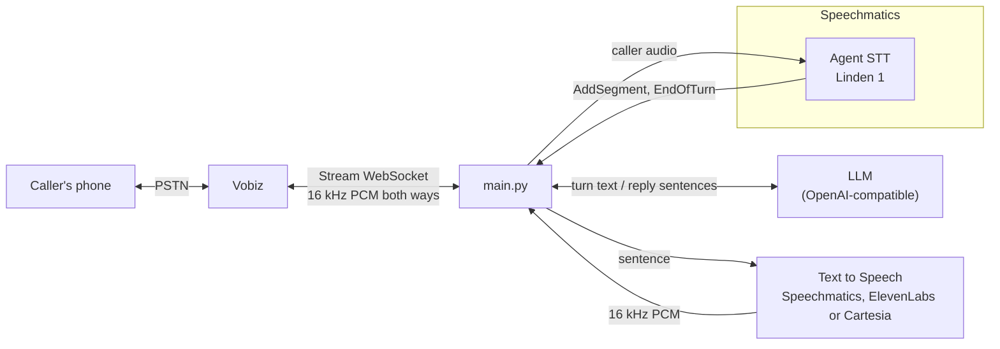

<div align="center">

<picture>
  <source media="(prefers-color-scheme: dark)" srcset="../logo/vobiz-dark.png">
  <source media="(prefers-color-scheme: light)" srcset="../logo/vobiz-light.png">
  
</picture>

# Phone Voice Agent - Vobiz + Speechmatics

**Answer phone calls with a voice agent that listens with Speechmatics agent STT and speaks with streamed Text to Speech.**

</div>

A Vobiz phone number streams the caller's audio to a small Python server over a bidirectional WebSocket. The server sends that audio to Speechmatics [agent STT](https://docs.speechmatics.com/speech-to-text/agent-stt) (Linden 1), the Speech to Text (STT) interface for voice agents, which detects the end of each caller turn. A [custom dictionary](https://docs.speechmatics.com/speech-to-text/features/custom-dictionary) makes sure brand names such as Vobiz are spelled correctly. The turn goes to an LLM, and each sentence of the reply is synthesized with Text to Speech (TTS) and played back into the call over the same WebSocket. No voice-agent framework or media server sits in between.

- **LLM**: any OpenAI-compatible chat completions endpoint. The default is Gemini through its [OpenAI-compatible API](https://ai.google.dev/gemini-api/docs/openai); `.env.example` also shows OpenAI.
- **TTS**: [Speechmatics TTS](https://docs.speechmatics.com/text-to-speech/quickstart) by default, or [ElevenLabs](https://elevenlabs.io/docs/api-reference) or [Cartesia](https://docs.cartesia.ai/), chosen with `TTS_PROVIDER`. Every option streams 16 kHz PCM straight into the call.

## What You'll Learn

- How to connect a Vobiz call to your server with a bidirectional `<Stream>` and play audio back with `playAudio`
- How to drive a conversation from agent STT events with the `speechmatics-agent-stt` SDK: `AddSegment`, `SpeechStarted`, `StartOfTurn` and `EndOfTurn`
- How to add a custom dictionary to agent STT with `additional_vocab` and `sounds_like`
- How to stream TTS output as 16 kHz PCM into a phone call, one sentence at a time, with the `speechmatics-tts` SDK or another provider's HTTP API
- How to handle barge-in with `clearAudio` without losing the reply to a cough, and how to hang up after the goodbye has played with `checkpoint` and `stop`

## Prerequisites

- **Speechmatics API key**: Create one in the [Speechmatics portal](https://portal.speechmatics.com/)
- **An LLM API key** for any OpenAI-compatible endpoint: [Gemini](https://aistudio.google.com/apikey) (default) or [OpenAI](https://platform.openai.com/api-keys)
- **Optional TTS key**: [ElevenLabs](https://elevenlabs.io/app/settings/api-keys) or [Cartesia](https://play.cartesia.ai/keys), only if you choose that provider instead of Speechmatics TTS
- **Vobiz account**: Sign up at [vobiz.ai](https://vobiz.ai/), buy a voice-capable number, and note your Auth ID and Auth Token from the [Vobiz console](https://console.vobiz.ai/)
- **A public HTTPS tunnel** to your machine, such as [ngrok](https://ngrok.com/) or [cloudflared](https://developers.cloudflare.com/cloudflare-one/connections/connect-networks/do-more-with-tunnels/trycloudflare/)
- **Python 3.12**

> [!NOTE]
> Speechmatics TTS supports English voices. Agent STT supports the languages listed in the [agent STT documentation](https://docs.speechmatics.com/speech-to-text/agent-stt); set `SM_LANGUAGE` to change the transcription language.

## Quick Start

> [!IMPORTANT]
> The answer URL, hangup URL, and audio WebSocket share a random path token that changes on every run unless you set `PATH_TOKEN`. The sample does not validate Vobiz callback signatures. Keep the token private, and add signature validation before exposing the server for anything other than a test.

### Python

**Step 1: Create and activate a virtual environment**

**On Windows (PowerShell):**
```powershell
cd python
python -m venv .venv
.\.venv\Scripts\Activate.ps1
```

**On macOS/Linux:**
```bash
cd python
python3 -m venv .venv
source .venv/bin/activate
```

**Step 2: Install dependencies**

```bash
python -m pip install -r requirements.txt
```

**Step 3: Start a tunnel**

In a second terminal, forward a public HTTPS URL to port 8765:

```bash
ngrok http 8765
```

Copy the `https://` forwarding URL.

**Step 4: Configure your keys**

**PowerShell:**

```powershell
Copy-Item ..\.env.example .env
```

**macOS/Linux:**

```bash
cp ../.env.example .env
```

Edit `python/.env` and set `SPEECHMATICS_API_KEY`, `GEMINI_API_KEY`, and `PUBLIC_URL` (the tunnel URL). To use OpenAI instead of Gemini, or ElevenLabs or Cartesia instead of Speechmatics TTS, follow the commented options in the file. Set the `VOBIZ_*` values if you want to place outbound calls with `dial.py`.

> [!IMPORTANT]
> **Why `.env`?** Never commit API keys to version control. The `.env` file keeps secrets out of your code.

**Step 5: Start the agent**

```bash
python main.py
```

It prints the answer URL:

```
00:16:56 Answer URL: https://abc123.ngrok-free.app/answer/Xq3...
00:16:56 Hangup URL: https://abc123.ngrok-free.app/hangup/Xq3...
00:16:56 TTS: Speechmatics (sarah)  LLM: gemini-3.1-flash-lite  Listening on http://127.0.0.1:8765
```

**Step 6: Make a call**

**Option A: Call the agent.** In the Vobiz console, create an application with the printed answer URL and hangup URL (method `POST`), attach your Vobiz number to it, then dial the number from any phone.

**Option B: Have the agent call you.** In a third terminal, from the `python` folder with the virtual environment active:

```bash
python dial.py +919876543210 --answer-url https://abc123.ngrok-free.app/answer/Xq3...
```

Your phone rings from `VOBIZ_FROM_NUMBER`. Answer it and start talking. Outbound calls are billed to your Vobiz account.

## Architecture



## How It Works

> [!NOTE]
> 1. **Answer**: Vobiz fetches `/answer/<token>`. The server returns a `<Stream bidirectional="true" keepCallAlive="true" audioTrack="inbound" contentType="audio/x-l16;rate=16000">` element that points at `/ws/<token>`.
> 2. **Listen**: Vobiz sends a `start` event, then 20 ms `media` frames of 16-bit PCM. The server forwards the decoded frames to agent STT as binary messages.
> 3. **Detect the turn**: Agent STT returns finalized `AddSegment` messages and an `EndOfTurn` when the caller has finished. A custom dictionary helps it spell "Speechmatics" and "Vobiz". The server joins the turn's segments and sends them to the LLM.
> 4. **Speak**: The LLM reply is streamed and split into sentences. Each sentence is sent to the TTS provider set by `TTS_PROVIDER`, asking for raw 16 kHz PCM; the audio is streamed back to Vobiz in 60 ms `playAudio` messages as it arrives. Each `playAudio` message carries only `event` and `media`; Vobiz plays it on the stream it arrives on. `checkpoint`, `clearAudio`, and `stop` carry the `streamId` from the `start` event.
> 5. **Barge-in**: When agent STT reports `SpeechStarted` while the agent is talking, the server sends `clearAudio` so Vobiz drops the queued audio, but keeps the reply. If `StartOfTurn` follows, the caller said words, so the reply is dropped. If no words follow within 2 seconds, the sound was a cough or an "mhm", and the agent carries on from the sentence it was cut off in.
> 6. **Hang up**: When the LLM ends its goodbye with `[END_CALL]`, the server sends a `checkpoint`. Vobiz answers with `playedStream` once the goodbye has played, and the server sends `stop` to end the call. The server also ends any call that reaches `MAX_CALL_SECONDS`.

### Code Walkthrough

Open one agent STT session per call. The SDK's default audio format, 16 kHz signed 16-bit PCM, is the format the `<Stream>` element asks Vobiz for, so frames pass straight through:

```python
self.stt = AgentSttAsyncClient(
    api_key=SM_API_KEY,
    app="speechmatics-academy/vobiz-phone-voice-agent",
    transcription_config=TranscriptionConfig(
        language=LANGUAGE, enable_partials=True, additional_vocab=CUSTOM_VOCAB
    ),
)
await self.stt.connect()  # returns once the service is ready for audio
...
await self.stt.send_audio(base64.b64decode(data["media"]["payload"]))
```

The custom dictionary lists each brand name with the ways callers say it, including mishearings seen on test calls:

```python
CUSTOM_VOCAB = [
    {"content": "Speechmatics", "sounds_like": ["speech matics", "speech mattics"]},
    {"content": "Vobiz", "sounds_like": ["vo biz", "voh biz", "voi biz", "fabius", "fabies"]},
]
```

React to turns instead of running your own silence detection. SDK handlers are synchronous, so the slow work runs in a task:

```python
@client.on(ServerMessageType.ADD_SEGMENT)
def on_segment(message):
    self.turn_text.append(message["segment"]["transcript"].strip())

@client.on(ServerMessageType.END_OF_TURN)
def on_turn_end(_message):
    self.reply_task = self.spawn(self.reply(" ".join(self.turn_text)))

@client.on(ServerMessageType.SPEECH_STARTED)  # any sound, even a cough
def on_voice_activity(_message):
    if self.speaking or self.paused:
        self.spawn(self.pause())  # clearAudio, keep the reply, replay it if no words follow

@client.on(ServerMessageType.START_OF_TURN)  # the caller's first recognized word
def on_turn_start(_message):
    self.spawn(self.barge_in())  # drop the reply, and clearAudio if it is playing
```

Each sentence's audio is kept as it is sent, so a paused reply can be replayed from the sentence the caller did not fully hear.

Stream TTS audio into the call as it arrives. With Speechmatics TTS, `generate()` returns the HTTP response before the audio has finished, and the PCM matches what `playAudio` declares, so there is no resampling. `tts_request()` makes the equivalent streaming request to ElevenLabs or Cartesia, so the loop is the same for every provider:

```python
response = await self.tts.generate(text=text, voice=SM_VOICE, output_format=tts.OutputFormat.RAW_PCM_16000)
async for chunk in response.content.iter_chunked(CHUNK):
    sentence.pcm += chunk
    await self.flush()  # base64 inside {"event": "playAudio", "media": {...}}
```

The full implementation is in [`python/main.py`](python/main.py). The agent's instructions are in [`assets/agent.md`](assets/agent.md).

## Expected Output

```
00:17:01 CALL      started call=4b0c... format={'encoding': 'audio/x-l16', 'sampleRate': 16000}
00:17:02 STT       Speechmatics session started 1b4f6675-...
00:17:02 AGENT     Hi, I'm Vee, the Vobiz voice assistant. ... What would you like to know?
00:17:11 CALLER    Can you tell me in one sentence what Vobiz is?
00:17:13 AGENT     Vobiz is a cloud telephony platform that provides phone numbers, voice calls, and tools for call control.
00:17:13 LATENCY   end of caller turn -> first agent audio: 1584 ms
00:17:25 PAUSE     caller made a sound over the agent, pausing until words follow
00:17:27 RESUME    no words followed, carrying on from: It handles calls through the cloud.
00:17:40 PAUSE     caller made a sound over the agent, pausing until words follow
00:17:41 BARGE-IN  caller spoke over the agent, dropping the reply
00:18:05 CALL      goodbye played, ending the call
00:18:05 CALL      ended
```

The timings above are example values. `LATENCY` measures from agent STT's `EndOfTurn` to the first TTS audio sent to Vobiz. It includes the LLM's time to the first sentence, so it depends on the model you choose.

## Key Features Demonstrated

**Agent STT turn detection:**
- The server never measures silence itself. `EndOfTurn` starts a reply, `SpeechStarted` pauses one, and `StartOfTurn` drops one.

**Custom dictionary:**
- `additional_vocab` with `sounds_like` steers agent STT toward "Speechmatics" and "Vobiz", including the mishearings seen on test calls.

**Barge-in that survives a cough:**
- Any sound pauses the agent at once, but only recognized words drop its reply. A cough or an "mhm" costs a short pause, not a lost answer.

**Streaming Text to Speech:**
- Replies are spoken sentence by sentence, so the caller hears the first sentence while the LLM is still writing the rest. Speechmatics TTS, ElevenLabs and Cartesia all stream into the same playback loop.

**Native phone audio:**
- Vobiz sends and accepts 16-bit PCM at 16 kHz, which is what agent STT takes and what each TTS provider returns when asked for raw 16 kHz PCM (`OutputFormat.RAW_PCM_16000` for Speechmatics TTS). There is no transcoding in either direction.

## Configuration Options

| Variable | Default | Purpose |
|---|---|---|
| `TTS_PROVIDER` | `speechmatics` | `speechmatics`, `elevenlabs`, or `cartesia` |
| `SM_VOICE` | `sarah` | Speechmatics TTS voice: `sarah`, `theo` (UK English), `megan`, `jack` (US English) |
| `ELEVENLABS_API_KEY` | unset | Required when `TTS_PROVIDER=elevenlabs`; the secret key, starting with `sk_` |
| `ELEVENLABS_MODEL` | `eleven_flash_v2_5` | ElevenLabs model |
| `ELEVENLABS_VOICE_ID` | `JBFqnCBsd6RMkjVDRZzb` (George) | ElevenLabs voice |
| `CARTESIA_API_KEY` | unset | Required when `TTS_PROVIDER=cartesia` |
| `CARTESIA_MODEL` | `sonic-3.6` | Cartesia model |
| `CARTESIA_VOICE_ID` | `62ae83ad-4f6a-430b-af41-a9bede9286ca` (Gemma) | Cartesia voice |
| `SM_LANGUAGE` | `en` | Agent STT language |
| `SPEECHMATICS_RT_URL` | `wss://eu2.rt.speechmatics.com/v2` | Agent STT region endpoint; the SDK adds `/agent` |
| `LLM_BASE_URL` | Gemini OpenAI-compatible URL | Any OpenAI-compatible base URL, such as `https://api.openai.com/v1` |
| `LLM_API_KEY` | `GEMINI_API_KEY` | Key for `LLM_BASE_URL`; falls back to `GEMINI_API_KEY` |
| `LLM_MODEL` | `gemini-3.1-flash-lite` | Chat model |
| `LLM_REASONING_EFFORT` | `minimal` | Sent as `reasoning_effort`; set it empty for models that reject the field |
| `LLM_TEMPERATURE` | `0.6` | Set `default` (or empty) for models that accept only their default temperature |
| `PORT` | `8765` | Local port |
| `PATH_TOKEN` | random per run | Secret path segment for the answer URL and WebSocket |
| `MAX_CALLS` | `5` | Calls handled at once; further streams are closed |
| `MAX_CALL_SECONDS` | `600` | Longest a call can last before the agent ends it |

Change what the agent knows and how it talks by editing [`assets/agent.md`](assets/agent.md).

## Next Steps

- **[Live Call Transcription](../02-live-call-transcription/)** - transcribe both people on a bridged Vobiz call with channel diarization
- **[Agent STT Linden 1](../../../basics/13-agent-stt/)** - the agent STT message flow in detail
- **[Text to Speech](../../../basics/06-text-to-speech/)** - the TTS SDK and voices

## Troubleshooting

**`Missing required settings in .env: ...`**
- Copy `.env.example` to `python/.env` and fill in the listed values.

**The call connects, then hangs up at once**
- Vobiz could not fetch the answer URL. Check that the tunnel forwards to port 8765 and that the application's answer URL matches the one `main.py` printed, including the token. Restarting `main.py` without `PATH_TOKEN` generates a new token.

**The call is silent and the log shows `STT       could not start a Speechmatics session` or `TTS       error`**
- Check `SPEECHMATICS_API_KEY`. With an invalid key the log names the authentication failure.

**`TTS       ElevenLabs error ...` or `TTS       Cartesia error ...`**
- Check the provider's API key and the status the log shows. For ElevenLabs, use the secret key that starts with `sk_`: pasting the key's ID instead returns `400` with `invalid_api_key`.

**`LLM error 400` or `LLM error 404`**
- Check `LLM_MODEL` is available to your key. If the error mentions `reasoning_effort`, set `LLM_REASONING_EFFORT=` (empty). If it mentions `temperature`, set `LLM_TEMPERATURE=default`: reasoning models accept only their default temperature.

**The agent talks over the caller, or stops too early**
- Barge-in is driven by agent STT. Any sound pauses the agent for up to 2 seconds (`RESUME_AFTER_SECONDS` in `main.py`); each new burst of background noise restarts the pause, so test from a quiet room first.

## Resources

- [Speechmatics agent STT](https://docs.speechmatics.com/speech-to-text/agent-stt)
- [Speechmatics Text to Speech](https://docs.speechmatics.com/text-to-speech/quickstart)
- [Speechmatics custom dictionary](https://docs.speechmatics.com/speech-to-text/features/custom-dictionary)
- [Vobiz `<Stream>` XML](https://www.vobiz.ai/docs/xml/stream)
- [Vobiz Make Call API](https://www.vobiz.ai/docs/call/make-call)

---

## Feedback

Help us improve this guide:
- Found an issue? [Report it](https://github.com/speechmatics/speechmatics-academy/issues)
- Have suggestions? [Open a discussion](https://github.com/speechmatics/community/discussions/categories/academy)

---

**Time to Complete**: 20 minutes
**Difficulty**: Intermediate
**APIs used**: Agent STT | Text to Speech

[Back to Integrations](../../) | [Back to Academy](../../../README.md)
