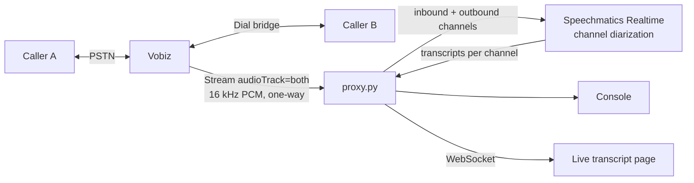

<div align="center">

<picture>
  <source media="(prefers-color-scheme: dark)" srcset="../logo/vobiz-dark.png">
  <source media="(prefers-color-scheme: light)" srcset="../logo/vobiz-light.png">
  
</picture>

# Live Call Transcription - Vobiz + Speechmatics

**Transcribe both people on a live phone call, each as a separate speaker, with the Realtime API and channel diarization.**

</div>

Someone calls your Vobiz number and Vobiz bridges them to a second phone. While they talk, Vobiz copies both sides of the call to a local proxy, which sends them to one Speechmatics [Realtime API](https://docs.speechmatics.com/speech-to-text/realtime/quickstart) session with [channel diarization](https://docs.speechmatics.com/speech-to-text/features/diarization). Transcripts appear in the console and in a live web page, labeled `inbound` (the caller) and `outbound` (the person they were bridged to).

The audio stream is one-way, so transcription never delays or changes the call itself.

## What You'll Learn

- How to copy both sides of a phone call to your server with Vobiz `<Stream audioTrack="both">` while `<Dial>` bridges the call
- How to feed two live audio tracks into one session with `AsyncMultiChannelClient` and `diarization="channel"`
- How to forward Vobiz's 16-bit PCM frames to Speechmatics without transcoding
- How to configure a Vobiz number's answer URL from code

## Prerequisites

- **Speechmatics API key**: Create one in the [Speechmatics portal](https://portal.speechmatics.com/)
- **Vobiz account**: Sign up at [vobiz.ai](https://vobiz.ai/), buy a voice-capable number, and note your Auth ID and Auth Token from the [Vobiz console](https://console.vobiz.ai/)
- **Two phones**: one to call your Vobiz number, and a second number for Vobiz to bridge the call to
- **A public HTTPS tunnel**: an [ngrok](https://ngrok.com/) auth token, or your own tunnel URL set as `PUBLIC_URL`
- **Python 3.12**

## Quick Start

> [!IMPORTANT]
> On startup the proxy creates or updates a Vobiz application named `speechmatics-transcription-<number>` and attaches `VOBIZ_PHONE_NUMBER` to it. If the number was attached to another application, the proxy prints that application's ID so you can re-attach it later. Use `--no-setup` to leave the number's routing alone. Bridged calls are billed to your Vobiz account.

### Python

**Step 1: Create and activate a virtual environment**

**On Windows (PowerShell):**
```powershell
cd python
python -m venv .venv
.\.venv\Scripts\Activate.ps1
```

**On macOS/Linux:**
```bash
cd python
python3 -m venv .venv
source .venv/bin/activate
```

**Step 2: Install dependencies**

```bash
python -m pip install -r requirements.txt
```

**Step 3: Configure your keys**

**PowerShell:**

```powershell
Copy-Item ..\.env.example .env
```

**macOS/Linux:**

```bash
cp ../.env.example .env
```

Edit `python/.env` and set `SPEECHMATICS_API_KEY`, `NGROK_AUTHTOKEN` (or `PUBLIC_URL`), `VOBIZ_AUTH_ID`, `VOBIZ_AUTH_TOKEN`, `VOBIZ_PHONE_NUMBER`, and `FORWARD_TO_NUMBER`.

> [!IMPORTANT]
> **Why `.env`?** Never commit API keys to version control. The `.env` file keeps secrets out of your code.

**Step 4: Start the proxy**

```bash
python proxy.py
```

**Step 5: Make a call**

Open the printed `Live transcript UI` link in a browser, then call `VOBIZ_PHONE_NUMBER` from any phone. You hear "This call is being transcribed", `FORWARD_TO_NUMBER` rings, and once it is answered both sides are transcribed live.

To have Vobiz place the first call instead, run `python proxy.py --call +919876543210`. When that person answers, they are bridged to `FORWARD_TO_NUMBER` in the same way.

## Architecture



## How It Works

> [!NOTE]
> 1. **Answer**: Vobiz fetches `/answer/<token>` and gets this VobizXML: a one-way `<Stream audioTrack="both" contentType="audio/x-l16;rate=16000">`, a short `<Speak>` greeting, and a `<Dial>` to `FORWARD_TO_NUMBER`. A one-way stream does not block, so Vobiz moves straight on to the greeting and the bridge.
> 2. **Stream**: Vobiz sends a `start` event, then `media` frames labeled `inbound` or `outbound`, each 20 ms of 16-bit PCM at 16 kHz (640 bytes).
> 3. **Transcribe**: The proxy decodes each frame and queues it for its channel. One `AsyncMultiChannelClient` session reads both queues and returns transcripts tagged with the channel label.
> 4. **End**: Vobiz closes the WebSocket when the call ends; it sends no stop event. The proxy closes both queues, and Speechmatics returns the final words before `EndOfTranscript`.

### Code Walkthrough

The answer XML forks the call to the proxy and bridges it:

```python
f'<Stream audioTrack="both" contentType="audio/x-l16;rate=16000">{escape(stream_url)}</Stream>'
"<Speak>This call is being transcribed.</Speak>"
f'<Dial callerId="{escape(caller_id)}" timeout="30"><Number>{escape(forward_to)}</Number></Dial>'
```

One Realtime session covers both tracks:

```python
transcription_config = TranscriptionConfig(
    language=LANGUAGE,
    max_delay=0.7,
    enable_partials=True,
    model=Model.ENHANCED,
    diarization="channel",
    channel_diarization_labels=["inbound", "outbound"],
)

async with AsyncMultiChannelClient(api_key=SM_API_KEY) as client:
    await client.transcribe(
        sources=self.sources,  # {"inbound": queue, "outbound": queue}
        transcription_config=transcription_config,
        audio_format=AudioFormat(encoding=AudioEncoding.PCM_S16LE, sample_rate=16000, chunk_size=640),
    )
```

Each source is an async queue whose `read()` waits for the next frame and returns empty bytes only after the call ends. Otherwise the client would treat a pause in one speaker's audio as the end of the stream. The full implementation is in [`python/proxy.py`](python/proxy.py); the web page is in [`python/ui.py`](python/ui.py).

## Expected Output

```
Listening on ws://localhost:5000/vobiz/<token>
Live transcript UI: http://localhost:5000/ui/<token>
Vobiz number +919876543210 pointed at https://xxxx.ngrok-free.app/answer/<token> (application speechmatics-transcription-919876543210). Call it now.

[vobiz] incoming audio stream connection
[vobiz] call started - stream=<stream id> call=<call id> tracks=['inbound', 'outbound'] format=audio/x-l16/16000
[outbound] This call is being transcribed.
[inbound ] Hello. Can you hear me?
[outbound] Yes, loud and clear.
[inbound ] Great.
[vobiz] call ended (stream=<stream id>)
```

- **inbound** is the person who called the Vobiz number (with `--call`, the person Vobiz called).
- **outbound** is the person the call was bridged to. The greeting also plays on this track.
- Transcripts from the two sides are printed as they arrive, so a sentence can be split across lines.

## Key Features Demonstrated

**Channel diarization:**
- Each person is on their own audio channel, so speaker labels come from the channel rather than from voice characteristics. Labels do not depend on how similar the two voices sound.

**One session for two tracks:**
- `AsyncMultiChannelClient` sends both channels over a single Realtime WebSocket connection.

**No transcoding:**
- Vobiz streams 16-bit PCM at 16 kHz, which the Realtime API accepts directly. The proxy also follows `start.mediaFormat`, so switching the `<Stream contentType>` to 8 kHz L16 or μ-law needs no other change.

## Configuration Options

| Variable | Default | Purpose |
|---|---|---|
| `SPEECHMATICS_LANGUAGE` | `en` | Transcription language, for example `hi` for Hindi. See [supported languages](https://docs.speechmatics.com/speech-to-text/languages) |
| `PUBLIC_URL` | unset | Your own `https://` tunnel; ngrok is not started when it is set |
| `SM_VOBIZ_PROXY_PORT` | `5000` | Local port |

Command-line options:

| Option | Effect |
|---|---|
| `--call NUMBER` | Place an outbound call to `NUMBER` and bridge it to `FORWARD_TO_NUMBER`; the number's routing is not changed |
| `--no-setup` | Only serve the answer URL and the web page; print the answer URL for you to configure in Vobiz yourself |

## Tests

The `python/tests` suite uses a fake WebSocket and mocks the Speechmatics client and the Vobiz API, so it contacts no live service:

```bash
python -m pip install -r requirements-dev.txt
python -m pytest
```

See [`python/tests/README.md`](python/tests/README.md) for what each file covers.

## Next Steps

- **[Phone Voice Agent](../01-phone-voice-agent/)** - answer calls with agent STT, an LLM, and Speechmatics TTS
- **[Channel Diarization](../../../basics/10-channel-diarization/)** - channel diarization with audio files
- **[Call Center Analytics](../../../use-cases/03-call-center-analytics/)** - analyze recorded calls with the Batch API

## Troubleshooting

**`Missing required env vars in .env: ...`**
- Copy `.env.example` to `python/.env` and fill in the listed values.

**`Could not authenticate with Speechmatics: ...`**
- The proxy checks your key before it opens a tunnel or changes your Vobiz number. Check `SPEECHMATICS_API_KEY`.

**`Vobiz number ... not found on this account`**
- Check that `VOBIZ_PHONE_NUMBER` is in E.164 form and belongs to the account whose Auth ID and Auth Token you set.

**`Could not configure the Vobiz number: ... returned 401`**
- Check `VOBIZ_AUTH_ID` and `VOBIZ_AUTH_TOKEN`.

**`Address already in use` on macOS**
- macOS uses port 5000 for AirPlay Receiver. Set `SM_VOBIZ_PROXY_PORT=5050`.

**The caller hears the greeting, then the call ends**
- The bridge did not connect. Check that `FORWARD_TO_NUMBER` is in E.164 form and that your account can call it; the call record in the Vobiz console shows the hangup cause.

**No transcripts appear**
- If you heard the greeting, Vobiz reached `/answer`. Check that the proxy printed `call started`; if it did, check `SPEECHMATICS_API_KEY`.

## Resources

- [Speechmatics Realtime API](https://docs.speechmatics.com/speech-to-text/realtime/quickstart)
- [Channel diarization](https://docs.speechmatics.com/speech-to-text/features/diarization)
- [Vobiz `<Stream>` XML](https://www.vobiz.ai/docs/xml/stream)
- [Vobiz `<Dial>` XML](https://www.vobiz.ai/docs/xml/dial)

---

## Feedback

Help us improve this guide:
- Found an issue? [Report it](https://github.com/speechmatics/speechmatics-academy/issues)
- Have suggestions? [Open a discussion](https://github.com/speechmatics/community/discussions/categories/academy)

---

**Time to Complete**: 20 minutes
**Difficulty**: Intermediate
**APIs used**: Realtime API

[Back to Integrations](../../) | [Back to Academy](../../../README.md)
