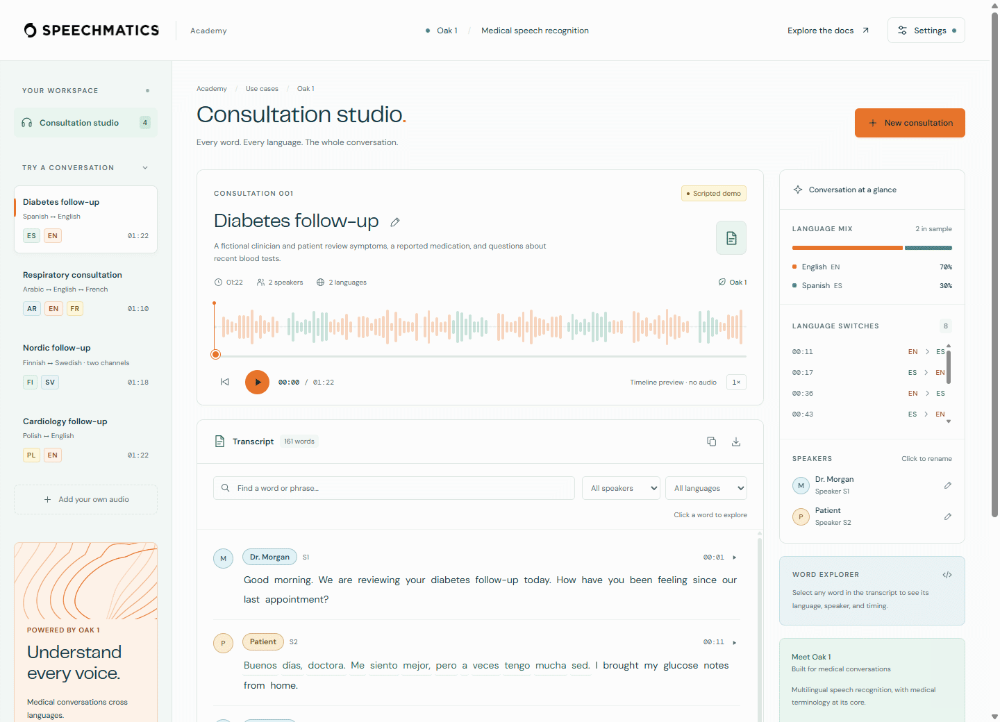
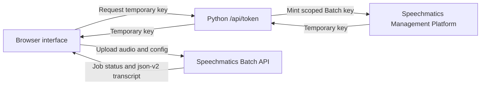

# Oak Consultation Studio

**Build a multilingual medical transcription workspace with Oak 1, a browser interface, and a serverless Python token broker.**

Upload a sound file or record a consultation, then explore its transcript by word, speaker, language, and timestamp. This example uses the Speechmatics **Batch API**: transcription starts automatically after an upload loads or a recording finishes.

**[Try the live demo](https://oak-consultation-studio.vercel.app/)** — explore the scripted consultations, or add your own Speechmatics API key in **Settings** to transcribe audio.



## What You'll Learn

- Select Oak 1 with `model: "oak-1"` and automatic multilingual recognition with `language: "multi"`.
- Use Python to exchange a permanent API key for a scoped temporary Batch key.
- Send audio directly from the browser to Speechmatics and retrieve an asynchronous job's results.
- Turn `json-v2` output into searchable transcripts with language labels, speaker controls, and audio seeking.
- Separate static hosting and short Python functions without keeping a transcription worker running.

Oak 1 is a standalone multilingual healthcare model for Batch transcription. It is distinct from Enhanced Medical, which selects a supported language pack with `domain="medical"`; do not add that domain flag to this Oak 1 request.

## Prerequisites

- **Speechmatics API key with Oak 1 Batch access**: get a key from [portal.speechmatics.com](https://portal.speechmatics.com/).
- **Python 3.10+**: use `python` on Windows and `python3` on Mac/Linux when creating the environment below.
- **A current browser** with audio playback support; microphone access requires localhost or HTTPS.
- **An audio file or microphone** for a live transcription. Scripted examples can be explored without a key.
- **Git** to clone the Academy, or download the repository instead.

No frontend build or Node.js installation is needed to run the app. Node.js 20+ is only needed for the JavaScript tests.

## Quick Start

### Step 1: Clone the Academy and enter the example

```bash
git clone https://github.com/speechmatics/speechmatics-academy.git
cd speechmatics-academy/use-cases/11-oak-consultation-studio
```

The Python entry point and `requirements.txt` live in this example's root alongside the static frontend and serverless handlers. Run the following commands from this directory.

### Step 2: Create and activate a virtual environment

**On Windows (PowerShell):**

```powershell
python -m venv .venv
.\.venv\Scripts\Activate.ps1
python -m pip install -r requirements.txt
```

**On Mac/Linux:**

```bash
python3 -m venv .venv
source .venv/bin/activate
python -m pip install -r requirements.txt
```

### Step 3: Choose how to provide your key

**In the app:** start the server in Step 4, open **Settings**, paste your key, and select **Save settings**. The key stays saved in this browser after a refresh. If no key is available, Settings pulses and a notification tells you where to add one.

**From `.env`:** copy the template before starting the server.

**On Windows (PowerShell):**

```powershell
Copy-Item .env.example .env
```

**On Mac/Linux:**

```bash
cp .env.example .env
```

Edit `.env` and set:

```dotenv
SPEECHMATICS_API_KEY=your_speechmatics_api_key
```

The local server discovers this key automatically; there is no environment selector in the UI. Restart the server after editing `.env`. A saved browser key takes precedence; **Clear saved key** restores the environment fallback.

> [!IMPORTANT]
> Do not commit `.env`. Keys entered in Settings are stored in this origin's `localStorage`, which is accessible to scripts on that origin. Use a trusted host and clear the saved key on shared devices. Environment keys remain on the Python side; the browser receives a temporary key.

### Step 4: Run the app

With the virtual environment activated, on any platform:

```bash
python dev_server.py --port 4173
```

Open [http://127.0.0.1:4173](http://127.0.0.1:4173). Optionally open **Settings → Expected languages** and select the languages you expect, then save. Leave the selection empty for automatic detection. Select **New consultation**:

1. Choose or drop an audio file. Transcription starts when it finishes loading, using **EU1, British English spelling, and speaker diarization**. The current UI cannot change those defaults before the initial submission; see [request configuration](#oak-1-request-configuration).
2. Alternatively, record through your microphone and select **Finish & transcribe**. Recordings are limited to five minutes.
3. During playback, the transcript follows the highlighted word so it stays visible. Click a word or the audio timeline to seek; a timeline seek also reveals the corresponding text.
4. Try search, language and speaker filters, the title edit button, and transcript download.
5. Open **See code** to inspect the request configuration.

Each upload or recording creates a separate consultation. Switching entries preserves their audio, titles, and transcription progress for the current page session.

Uploaded and recorded audio gets a waveform calculated locally from the sound's amplitude. It appears independently of transcription, retains language colors when a transcript is available, and stays attached to its consultation. Scripted showcases use illustrative bars because they contain no audio. If the browser cannot decode a waveform, playback and transcription can still continue.

Consecutive words with the same language are displayed as a paragraph with a language tag, within their speaker's turn, following the Flutter example. Each word remains clickable for playback and Word Explorer. This groups the API's original labels without smoothing or hiding brief language changes.

Language colors come from one shared palette across the waveform, paragraph tags, language summary, and badges, including languages outside the scripted showcases. Tags use darker text shades for readability. Colors stay stable when filtering, and waveform language segments continue through gaps between words instead of reverting to English's color.

## How It Works



1. **Resolve credentials.** The Python broker uses the supplied browser key or the allowed environment key. `/api/config` exposes only availability flags.
2. **Mint a temporary key.** [token_service.py](token_service.py) requests a 10-minute Batch token. A signed, HttpOnly scope cookie lets the same visitor renew access to their jobs.
3. **Submit audio directly.** [public/batch-client.js](public/batch-client.js) sends multipart `data_file` and `config` to Speechmatics. Audio does not pass through the Python function.
4. **Retrieve the result.** The browser polls job status, renews temporary credentials when needed, and retrieves `json-v2` after completion.
5. **Render the transcript.** [public/batch-transcript.js](public/batch-transcript.js) normalizes words, punctuation, speakers, languages, and timestamps for the UI. [public/consultation-library.js](public/consultation-library.js) keeps each consultation's state separate.

[public/audio-waveform.js](public/audio-waveform.js) decodes a separate, low-sample-rate preview in the browser and reduces it to normalized amplitude peaks. Only those peaks are retained for the timeline; the original audio used for playback and transcription is unchanged.

### Oak 1 request configuration

The actual configuration is built by [`createRequestConfig()` in public/transcript.js](public/transcript.js#L103):

```javascript
export function createRequestConfig({ locale = 'en-GB', diarization = 'speaker', hints = [] } = {}) {
  return {
    type: 'transcription',
    transcription_config: {
      model: 'oak-1', language: 'multi', diarization,
      ...(locale ? { output_locale: locale } : {}),
      ...(Array.isArray(hints) && hints.length ? { language_hints: [...hints] } : {}),
    },
  };
}
```

For example, `createRequestConfig({ locale: 'en-US' })` produces:

```json
{
  "type": "transcription",
  "transcription_config": {
    "model": "oak-1",
    "language": "multi",
    "diarization": "speaker",
    "output_locale": "en-US"
  }
}
```

`output_locale` controls English spelling. **Settings → Expected languages** optionally adds `language_hints` to new uploads and recordings; selecting English, Latvian, and Russian sends `"language_hints": ["en", "lv", "ru"]`. The empty default omits the field for automatic detection. This example does not send `language_hints_strict` or guarantee that language labels will be error-free.

Expected languages persist in this browser through [public/language-preferences.js](public/language-preferences.js). Every consultation captures its own selection when audio is added, so later Settings changes do not alter an existing job or its retries. **See code** shows the current consultation's captured hints; demos retain their optional sample-language preview toggle.

**First-upload limitation:** changing the scripted demo's request preview does not set defaults for your next upload. For a US1-only or channel-diarization workflow, change the defaults in `public/consultation-library.js` before adding audio; the current Settings panel does not expose them.

The regional endpoint is defined separately in [public/batch-endpoints.js](public/batch-endpoints.js). **EU1 is the default** (`https://eu1.asr.api.speechmatics.com/v2`); US1 is also available. Oak 1 does not support the global Batch endpoint. **See code** previews region, English spelling, and diarization options. For a local consultation whose submission has not succeeded, you can adjust these before retrying; a submitted job keeps its original configuration and region.

### Serverless deployment

The included [vercel.json](vercel.json) uses this example as the project root, serves `public/`, and exposes the Python handlers in `api/`. There is no database, application object storage, or long-running transcription function. Other hosts need equivalent static-file and Python-function routing.

To deploy your own copy, run the following from this example's directory and follow the Vercel CLI prompts to select your account and project:

```bash
npx vercel --prod
```

[.vercelignore](.vercelignore) excludes local environment files, virtual environments, tests, and documentation assets from deployment. Keep the project root set to this example directory.

Remote deployments default to visitors supplying their own keys. An environment key can be enabled with `SPEECHMATICS_ENABLE_ENV_KEY=true`, but only on access-protected hosting with abuse and rate controls: visitors otherwise spend the deployment owner's allowance. Configure secrets in the hosting platform, never in `public/` or a committed `.env`.

> [!NOTE]
> The [live Vercel deployment](https://oak-consultation-studio.vercel.app/) has been verified for frontend loading, Python API routing, origin checks, and Speechmatics credential validation. End-to-end audio transcription has been exercised locally. The hosted demo uses visitor-provided keys; it has no shared Speechmatics API key.

## Expected Output

The server prints:

```text
Oak Consultation Studio: http://127.0.0.1:4173/
```

After a successful upload or recording, the new consultation shows a transcript with word timings, available language and speaker labels, and audio playback. Search and filters narrow the transcript; clicking the timeline reveals the matching text. Consultation titles and speaker display names can be edited, and the transcript can be copied or downloaded as text.

Four scripted consultations are available immediately: **Spanish–English**, **Arabic–English–French**, **Finnish–Swedish**, and **Polish–English**. The Nordic example illustrates separate audio channels; the Arabic example includes right-to-left text.

Without a configured key, the showcase banner offers **Add API key** and opens Settings. Once a saved browser key or the automatic environment key is available, it offers **Add your audio** and opens the upload/record dialog.

> [!NOTE]
> These are fictional, authored transcripts with synthetic timings. They have no bundled audio, so their timelines play silently. They demonstrate the interface, not recognition accuracy. Upload your own audio to see real Oak 1 output; the app does not generate clinical summaries, diagnoses, or extracted medical entities.

Audio, transcripts, and job state are held in page memory and are lost on refresh; the saved API key persists. A submitted Speechmatics job may continue after you close or reload the page. Download any transcript you want to keep.

## Troubleshooting

| Issue | What to check |
|---|---|
| Settings pulses or transcription asks for a key | Save a key in **Settings**, or add it to the app-root `.env` and restart Python. Then use **Transcribe audio** on the retained consultation. |
| API key rejected or access denied | Check the key and its Oak 1 Batch access in the Portal. A supplied browser key takes precedence over `.env`; clear or replace it if needed. |
| Token endpoint unavailable | Run `python dev_server.py --port 4173`. A static file server alone cannot provide `/api/token`. |
| Microphone cannot start | Open the app on localhost or HTTPS, grant microphone permission, and check the selected input device. You can upload a file instead. |
| File cannot load or is too large | Use a browser-supported audio format, preferably WAV for a first test. The app limit is **100 MiB**. WebM is converted locally to PCM WAV, and the larger converted file must also fit the limit. |
| Result checking was interrupted | Select **Resume transcription** to check the existing job without uploading again. Keep access to the original account; the job stays on its original region. |
| Upload response was lost | Check the Speechmatics portal before retrying: the remote job may have been accepted even though the browser did not receive its ID. |
| Sample playback is silent | Scripted examples contain no audio. Upload or record a consultation to test audible playback. |
| PowerShell blocks virtual environment activation | You can skip activation: run `.\.venv\Scripts\python.exe -m pip install -r requirements.txt`, then `.\.venv\Scripts\python.exe dev_server.py --port 4173`. |

**Cancel this job** requests deletion of a known remote job. **Stop tracking this job** only stops tracking it locally; it does not cancel the Speechmatics job. If cancellation cannot be confirmed, check the Portal.

## Development Checks

From this directory, with Python dependencies installed and Node.js 20+ available:

```bash
npm test
python -m unittest discover -s tests -p "test_*.py"
```

The suites cover transcript navigation, audio conversion, automatic transcription, consultation state, key persistence, job recovery, and Python credential handling. For repository-wide checks and contribution requirements, see [Contributing to Speechmatics Academy](../../docs/CONTRIBUTING.md).

## Next Steps

- **[Melia 1 Multilingual Transcription](../../basics/12-melia-multilingual/)** — learn a minimal multilingual Batch SDK workflow with Melia 1.
- **[Medical Microbatching](../07-medical-microbatching/)** — split continuous microphone audio into Batch jobs with Python.
- **[Wall of Voices](../10-wall-of-voices/)** — explore multilingual language switching over the Realtime API.

## Resources

- [Oak 1 and model capabilities](https://docs.speechmatics.com/speech-to-text/models#oak-1)
- [Supported medical languages](https://docs.speechmatics.com/speech-to-text/languages#medical-languages)
- [Authentication and temporary keys](https://docs.speechmatics.com/get-started/authentication#temporary-keys)
- [Batch audio input](https://docs.speechmatics.com/speech-to-text/batch/input)
- [Batch transcript output](https://docs.speechmatics.com/speech-to-text/batch/output)

---

## Feedback

Help us improve this guide:

- Found an issue? [Report it](https://github.com/speechmatics/speechmatics-academy/issues).
- Have suggestions? [Open a discussion](https://github.com/orgs/speechmatics/discussions/categories/academy).

---

**Time to Complete**: 20 minutes  
**Difficulty**: Intermediate  
**API Mode**: Batch  
**Languages**: Python, JavaScript

[Back to Use Cases](../) | [Back to Academy](../../README.md)
